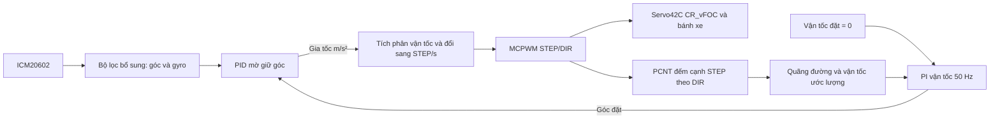

# Xe cân bằng: ESP32-S3, ICM20602, MKS Servo42C

> Cập nhật lọc và di chuyển 03/11/2026: [ICM20602](BAO_CAO_ICM20602_LOC_NHIEU.md), [MKS42C/17HS4401S](BAO_CAO_MKS42C_17HS4401S.md). Runtime không DMP; PT1 chỉ nhánh D; có lệnh di chuyển có hạn; R01 đã sửa.

Rà soát tài liệu ngày 03/11/2026. Bắt đầu với [hướng dẫn sử dụng](HUONG_DAN_SU_DUNG.md)
và [checklist tính năng](CHECKLIST_TINH_NANG.md); xem [báo cáo kiểm tra](KET_QUA_RA_SOAT_2026-11-03.md).

Firmware dùng PID mờ giữ góc, PI vận tốc và phát STEP/DIR bằng MCPWM.
Đọc [hướng dẫn lập trình từng bước](HUONG_DAN_LAP_TRINH.md) để hiểu tên biến và cách đọc mã.
Tài liệu đầy đủ: [logic chương trình](LOGIC_CHUONG_TRINH.md),
[danh mục toàn bộ hàm](DANH_MUC_HAM.md), [cách sửa và kiểm thử](HUONG_DAN_SUA_VA_KIEM_THU.md).
Servo42C chạy `CR_vFOC`, tự khép vòng bằng encoder tích hợp. ESP32 dùng số
xung STEP đã phát để ước lượng chuyển động bánh, với giả thiết motor bám xung,
tỉ số truyền đúng cấu hình và bánh không trượt. Firmware không đọc UART của MKS.

## Luồng điều khiển



- IMU lấy mẫu theo ngắt data-ready ở 200 Hz. ISR chỉ lưu thời điểm và đánh thức task.
- MotorTask sở hữu duy nhất motor và bộ đếm xung; timer đánh thức mỗi 250 µs.
- GiamSatDongCo dùng GPTimer ISR riêng để tắt EN khi quá hạn phục vụ/lệnh;
  callback này không chờ MotorTask. Sau khi MotorTask chạy lại, driver dừng STEP và giữ lỗi.
- Mỗi lần bật có mã phiên mới và chờ ControlTask reset, xác nhận lệnh bằng 0.
- Bảo vệ tư thế xét thêm góc nghiêng ngang, độ lớn gia tốc và chất lượng mẫu.
- PCNT dùng chính input path của GPIO STEP/DIR đã cấu hình output: không cần thêm
  chân hoặc dây phản hồi. Đếm cạnh lên, DIR xác định dấu, có bù tràn phần cứng.
- ControlTask dùng mẫu mới nhất qua queue dài 1; không tích lũy các lệnh cũ.
- Console ghi log riêng với chu kỳ 200 ms. Không gọi Serial trong vòng điều khiển.

Với cấu hình hiện tại: `200 × 32 × 1 = 6400` xung/vòng bánh,
`2π × 0,04 / 6400 ≈ 0,00003927 m/xung`. Quãng đường dọc là trung bình hai bánh.
Tần số STEP chỉ là lệnh tốc độ; phản hồi ước lượng dùng **cạnh xung đã đếm**,
bao gồm xung thưa và khoảng ngừng khi đổi DIR. Đếm xung không phát hiện được
sai lệch bám của MKS, bánh trượt hoặc chuyển động do đẩy khi motor disabled.

## Cấu hình

| File | Nội dung |
| --- | --- |
| `include/config/ImuConfig.h` | Bus, nhịp mẫu, DLPF và bộ lọc; góc gá nằm trong ImuMountConfig.h |
| `include/config/RobotGeometry.h` | Bán kính bánh, tỉ số truyền và kích thước cơ khí |
| `include/config/MotorConfig.h` | Số bước, vi bước đầu vào MKS, STEP/DIR/EN, timing và watchdog |
| `include/config/ControlConfig.h` | PID góc, PI vận tốc, miền mờ và giới hạn điều khiển |
| `include/config/SafetyConfig.h` | Tuổi mẫu/lệnh tối đa, góc ngã và điều kiện arm |

Driver `Icm20602Driver` kiểm tra `WHO_AM_I = 0x12`, cấu hình cả gyro/accel DLPF,
đọc lại cấu hình và hiệu chuẩn bias gyro trước khi tạo task.
Khung dữ liệu hiện hành là `KhungDuLieuImu`; các alias MPU và cấu hình cũ giữ tương thích bench;
chương trình chính dùng driver ICM20602. Driver MPU6050 cũ vẫn dành cho các bench cũ.

Quy ước mặc định: trục X hướng trước, Z hướng lên, nghiêng trước là góc dương
quanh Y. Khi lắp khác, cấu hình phép quay trong `ImuMountConfig.h`. Góc dùng radian,
gyro rad/s, vận tốc m/s, lệnh bánh là STEP/s có dấu theo chiều tiến của xe.

Các hệ số điều khiển vừa bổ sung là **giá trị khởi đầu cần tinh chỉnh**:
`Kp = 30`, `Ki = 0`, `Kd = 3`; đầu ra PID là gia tốc, giới hạn ±3 m/s².
Vận tốc sau tích phân bị chặn theo trần STEP của driver; tích phân PID/PI có
chống bão hòa và được reset khi disabled hoặc lỗi. Ki hiện bằng 0 để thử PD trước;
có thể chỉnh `kiGoc` sau khi xác nhận động học trên xe.

PID mờ dùng 5 tập `NB, NS, Z, PS, PB`, 25 luật Sugeno bậc 0, AND tích và
giải mờ trung bình có trọng số. Hai đầu vào là `θ − θđặt` và gyro trục nghiêng
(D trên tín hiệu đo để tránh xung đạo hàm khi đổi góc đặt). Các bảng nhân Kp/Ki/Kd
nằm trong `lib/controllers/AnglePidController.cpp`; giới hạn lần lượt là
`[1; 1,4]`, `[0; 1]`, `[1; 1,5]` lần hệ số cơ sở. Khi bỏ mờ, dùng hệ số cơ sở.
Vòng vận tốc đưa góc đặt về miền ±0,1 rad quanh góc cân bằng. Mặc định vận tốc đặt 0;
có lệnh thử tiến/lùi/quay qua Serial; chưa có vòng giữ vị trí/hướng tuyệt đối.

## Biên dịch và kiểm thử

```powershell
pio run -e lolin_s3_mini
./test/run_native.ps1 -TrinhBienDich g++
```

Script native cần GCC C++17. Có thể truyền đường dẫn đầy đủ tới `g++.exe`.
Nó kiểm tra đơn vị/quy đổi xung, đảo chiều, xung thưa, lọc vận tốc, hợp nhất IMU,
mẫu lỗi/quá hạn, giới hạn PID mờ, reset và mô hình con lắc ngược lý tưởng
với PID cố định/PID mờ và điều khiển tầng. Mô hình không thay thế thử nghiệm xe thật.

Môi trường PlatformIO đang dùng cấu hình `lolin_s3_mini` đã có trong dự án;
đối chiếu flash/PSRAM của Super Mini thực tế nếu board của bạn khác cấu hình này.

## Thử trên xe

1. Đặt MKS ở `CR_vFOC`, motor 1,8°, `MStep = 32`, `EN = L` khớp cấu hình
   hiện tại và hiệu chuẩn encoder nội bộ của MKS. Đối chiếu mức điện và timing STEP/DIR.
2. Nạp firmware, giữ xe đứng yên lúc hiệu chuẩn gyro. Mặc định motor disabled.
   Quan sát `theta` khi nghiêng: nghiêng trước phải dương; `rate` cũng dương lúc
   bắt đầu nghiêng trước. `roll` phải thay đổi khi nghiêng ngang. Hiệu chỉnh góc gá qua ImuMountConfig.h nếu cần.
3. Cờ `daXacNhanCauHinhPhanCungMotor` hiện vẫn là `false` theo cấu hình sẵn có.
   Sau khi xác nhận EN/DIR/timing trên phần cứng, đặt `true` và biên dịch lại để cho arm.
4. Kê bánh và giữ thân xe khi thử chiều tác động. Gửi `a` lúc xe gần thẳng và ít
   chuyển động. Nghiêng trước phải làm cả hai bánh chạy tiến. Log `STEP` phải đổi
   dấu đúng theo chuyển động được ra lệnh. Đối chiếu số cạnh với logic analyzer
   hoặc phép thử số vòng trước khi dựa vào PCNT làm odometry.
5. Gửi `d`, rồi `f` để tắt mờ khi disabled. Chỉnh bộ PD cơ sở trước, sau đó so sánh
   với mờ bằng cùng điều kiện thử; chỉnh PI vận tốc sau khi vòng góc đã ổn định.
6. Kiểm tra `d`, `x`, ngắt IMU và timeout. Lỗi khi đang chạy được giữ lại;
   gửi `k` để xóa khi đã disabled, rồi gửi `a` riêng để bật lại.

| Lệnh Serial, 115200 baud | Hành động |
| --- | --- |
| `a` | Yêu cầu bật: chờ lệnh 0 đúng phiên, dữ liệu mới và tư thế phù hợp |
| `d` | Tắt motor |
| `x` | Dừng khẩn và giữ lỗi |
| `k` | Xóa lỗi khi motor đã tắt; không tự arm |
| `f` | Đổi PID cố định/mờ khi motor đã tắt |
| `h` | In danh sách lệnh |

Trong log, `ready=none` là mẫu đủ điều kiện tính điều khiển; điều kiện arm còn
kiểm tra góc/tốc độ nghiêng và cờ phần cứng. `fault` là lỗi ứng dụng giữ lại,
`motorFault` là mã lỗi driver, `last` là kết quả API MKS gần nhất.
`last=6` nghĩa cấu hình phần cứng chưa xác nhận. `serviceMax` là khoảng cách lớn
nhất giữa hai lượt MotorTask, cần dưới 2000 µs khi chạy. `theta/rate` dùng rad/rad/s,
`x/v` dùng m/m/s, `STEP` là tổng cạnh có dấu, `cmd` là STEP/s đã giới hạn.
`phase`: 0=tắt, 1=chờ xác nhận, 2=chạy; `epoch` là mã phiên.
`miss/dup/overlap` đếm mẫu ngắt bỏ lỡ, thông báo trùng và lần đọc trùng thời điểm ngắt mới.
`motorFault=7` là giám sát GPTimer đã ngắt EN. Giám sát này vẫn phụ thuộc CPU/ngắt
được phục vụ; không cam kết thời gian ngắt khi ngắt bị khóa hoặc flash cache bị vô hiệu hóa.

## Tài liệu phần cứng

- [TDK ICM20602, DS-000176](https://invensense.tdk.com/wp-content/uploads/2020/11/DS-000176-ICM-20602-v1.1.pdf)
- [Makerbase Servo42C V1.1](https://github.com/makerbase-mks/MKS-SERVO42C/wiki/Serial-communication-description)
- [Espressif PCNT ESP32-S3](https://docs.espressif.com/projects/esp-idf/en/v5.5.6/esp32s3/api-reference/peripherals/pcnt.html)
