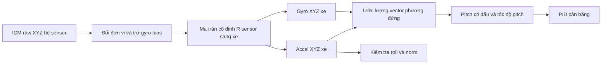

# Báo cáo bù lệch lắp ICM20602 và ước lượng vector nghiêng

Cập nhật **05/11/2026**. Người dùng đã xác nhận cảm biến vẫn là **ICM20602**;
ICM20605 là tên gõ nhầm. Driver, WHO_AM_I và hệ số chuyển đổi không đổi loại chip.
Mã mới nằm ở `HeTrucImu`, `ImuMountConfig` và `ComplementaryEstimator`.

**Phân biệt hai cách hiệu chuẩn:** phần công cụ offline/two-vector trong báo cáo
này cần tư thế thân chuẩn thẳng đã biết. UI nút/LED hiện mặc định dùng lượt lật
trái–phải, giữ trục dọc đo từ gyro để không xóa pitch người đang đỡ. Không áp dụng
giả thiết “gravity mốc đầu là Z thân” cho UI này. Xem
[báo cáo sơ đồ và calib mới](DOI_CHIEU_SO_DO_VA_FLOW_CALIB.md) cùng
[hướng dẫn thao tác](HUONG_DAN_UI_CALIB.md). Cấu hình `ImuMountConfig.h` chỉ là
nguồn ma trận runtime khi `batUiCalib = false`; góc cân bằng cơ học luôn xác định riêng.

## 1. Đánh giá hai loại lệch lắp

**Xoay chéo trên mặt PCB:** trục tiến của xe không song song X/Y của sensor.
Một chuyển động pitch của xe sẽ xuất hiện trên nhiều trục sensor. Chọn nguyên
gyroY hoặc accelX làm giảm hệ số đo và trộn một phần chuyển động vào roll giả.

**PCB/module bị nghiêng khi gá:** ngay khi khung xe thẳng, accelerometer đã có
thành phần X/Y. Trừ một offset pitch chỉ xử lý được một tư thế gần điểm hiệu
chuẩn, không sửa đồng thời hướng gyro, roll và ảnh hưởng khi xe quay.

Giải pháp là một phép quay cố định từ hệ sensor sang hệ xe, áp dụng **cả accel
và gyro**, sau khi driver đổi đơn vị và trừ bias gyro. Việc góc lắp khác0 không
buộc phải thiết kế lại PCB nếu vị trí gá cứng, ổn định và đo được góc lắp. Tuy
nhiên phép quay không xử lý được PCB rung/lỏng, nhiễu nguồn hoặc biến dạng gá.

Nền tảng toán học về hệ trục, góc nghiêng và giới hạn dùng trọng lực được đối chiếu
với [NXP AN3461](https://www.nxp.com.cn/docs/en/application-note/AN3461.pdf).
Tài liệu NXP dùng quy ước trục/dấu khác ở một số phần; công thức trong code dưới
đây dùng nhất quán hệ X tiến, Y trái, Z lên của xe.

## 2. Hệ trục và ma trận quay

- S: hệ trục vật lý của cảm biến, trước khi bù góc lắp.
- B: hệ xe, X tiến, Y trái, Z lên, hệ tay phải.
- Gia tốc đứng yên khi xe thẳng: `a_B ≈ [0,0,+g]`.
- Nghiêng thân về trước: pitch dương, quay quanh Y của xe theo chiều dương.

```text
a_B = R_BS * a_S
omega_B = R_BS * (omega_S - bias_S)
R_BS * transpose(R_BS) = I
det(R_BS) = +1
```

Bias đã được driver trừ trước khi gọi `HeTrucImu`, nên estimator không trừ lại.
Mã kiểm tra tất cả phần tử hữu hạn, độ trực giao và determinant; ma trận sai
không được âm thầm thay bằng identity. Ứng dụng báo BOOT ERROR và giữ motor tắt.



Phép quay chỉ đổi tọa độ, không thêm một bộ lọc gây trễ pha. Hai vector cần18 phép
nhân và12 phép cộng cho ma trận3×3; sin/cos của góc gá tính một lần lúc tạo đối
tượng. Phần dự đoán tư thế3D có chi phí riêng và vẫn cần đo timing trên ESP32.

## 3. Trường hợp chỉ xoay chéo X–Y

Nếu X sensor xoay một góc ψ về bên trái so với X xe khi nhìn từ trên:

```text
R_BS = [ cosψ  -sinψ  0
         sinψ   cosψ  0
           0      0   1 ]

a_tien = cosψ*a_Sx - sinψ*a_Sy
gyro_pitch_body = sinψ*gyro_Sx + cosψ*gyro_Sy
```

Đây là **phép chiếu có dấu**. Công thức `sqrt(aX²+aY²)` chỉ cho độ lớn ngang,
không phân biệt tiến/lùi hoặc nghiêng ngang; không dùng đại lượng đó thay sai
lệch có dấu của PID. Với PCB còn nghiêng roll/pitch, phải dùng đủ XYZ.

Ví dụ pitch xe thật10°, roll xe0°, gyro pitch thật0,3rad/s:

| Góc gá yaw | Pitch nếu dùng cách cũ | Roll giả | GyroY sensor | Sau bù ma trận |
| --- | --- | --- | --- | --- |
| 15° | 9,6658° | 2,6130° | 0,289778 | Pitch10°, gyro pitch0,3 |
| 30° | 8,6822° | 5,0384° | 0,259808 | Pitch10°, gyro pitch0,3 |
| 45° | 7,1071° | 7,1071° | 0,212132 | Pitch10°, gyro pitch0,3 |

Hệ số gyro bị giảm theo cosψ: tại30° mất13,40%, tại45° mất29,29%. Điều này làm
thay đổi độ khuếch đại hữu hiệu của vòng PID. Phép quay chuẩn còn bảo toàn norm
và không khuếch đại nhiễu đẳng hướng chỉ vì cảm biến lắp chéo.

## 4. Kết hợp lệch roll/pitch/yaw của gá

Cấu hình Euler được định nghĩa rõ là:

```text
R_BS = Rz(gocLapYaw) * Ry(gocLapPitch) * Rx(gocLapRoll)
```

Đó là góc định hướng của **hệ sensor so với hệ xe**, tương đương quay active lần
lượt quanh các trục xe cố định X rồi Y rồi Z. Không đảo thứ tự tùy ý. Nếu góc
được đo cho phép biến đổi xe→sensor, cần transpose để lấy sensor→xe.

Ví dụ gá roll=-4°, pitch=+5°, yaw=+30° cho:

```text
R_BS ≈ [ 0.862729916  -0.504047180   0.040416987
         0.498097349   0.860875971   0.103882596
        -0.087155743  -0.069491029   0.993768018 ]
```

Khi thân thẳng, cách cũ báo pitch5,0121° và roll-4°. Khi thân nghiêng tiến10°,
cách cũ báo pitch13,6321° và roll1,1256°. Sau bù, mô hình lý tưởng khôi phục đúng
pitch0°/10° và roll0°. Đây là số minh họa từ ma trận, chưa phải góc gá của xe bạn.

Bảng đầy đủ gồm cả nghiêng lùi:
[Markdown](du_lieu_tinh_toan/TINH_TOAN_GOC_LAP.md),
[CSV](du_lieu_tinh_toan/sai_so_goc_lap.csv),
[ma trận minh họa JSON](du_lieu_tinh_toan/vi_du_hieu_chuan_lap.json).

## 5. Ước lượng vector phương đứng trên xe

Sau khi xoay về hệ xe, estimator lưu vector đơn vị `u` biểu diễn phương đứng
trong hệ xe. Thay vì chỉ cộng gyroY vào một góc, dùng đủ ba gyro:

```text
du/dt = -omega_B × u
u_predict = Rodrigues(trục=omega_B/|omega_B|, góc=-|omega_B|*dt) * u
u_accel = a_B / |a_B|
innovation = acos(clamp(dot(u_predict,u_accel), -1, +1))
u = normalize((1-k)*u_predict + k*u_accel)
```

`k` vẫn dùng trọng số norm/innovation và tau bổ sung đã thiết kế. `innov` trong
log nay là **góc sai lệch vector3D không âm**, không còn sai lệch pitch1D có dấu.
Mất tin cậy kéo dài vẫn làm estimator báo lỗi; app giữ lỗi và dừng motor.

Pitch và roll Euler từ gia tốc, theo quy ước này:

```text
theta = atan2(-u_x, sqrt(u_y² + u_z²))
phi = atan2(u_y, u_z)
theta_dot = q*cos(phi) - r*sin(phi)
phi_dot = p + tan(theta)*(q*sin(phi) + r*cos(phi))
```

Trong code, pitch và tốc độ được tính trực tiếp từ vector đã hợp nhất. Roll
phục vụ bảo vệ tiếp tục lấy từ accel đã xoay để không che một tư thế ngã bằng
lọc chậm. Gyro p/q/r đều đã ở hệ xe. Gần pitch±90° có suy biến Euler; code từ
chối góc hợp lệ ở vùng suy biến, vốn nằm ngoài vùng cân bằng.

Ví dụ thân đang roll20°, pitch10° và quay quanh phương đứng thế giới: gyro body
có cả ba thành phần, nhưng pitch thật phải giữ nguyên. Test mới kiểm tra tình
huống đó; cách lấy riêng gyroY có thể tạo pitch giả.

`tilt=atan2(sqrt(u_x²+u_y²),u_z)` là độ nghiêng tổng không có dấu.
`tiltDir=atan2(-u_y,-u_x)` là hướng nghiêng trong XY xe:0 về trước, +π/2 về trái.
Khi đứng thẳng, hướng nghiêng không xác định; code quy ước in0. PID vẫn cần pitch
có dấu; không dùng tilt tổng thay pitch. Bộ lọc này ước lượng nghiêng3D, chưa
cung cấp heading/yaw tuyệt đối.

## 6. Vì sao không tự hiệu chuẩn mọi góc lúc boot?

Một vector trọng lực đứng yên xác định phương đứng nhưng không xác định yaw lắp
quanh phương đó. Để biết hướng tiến, cần thêm một hướng cơ khí đã biết. Ngoài ra,
nếu lấy tư thế đang ngã lúc boot làm “thẳng”, bảo vệ canArm/Fallen sẽ bị vô hiệu.
Giới hạn quan sát quanh trọng lực cũng được nêu trong [NXP AN3461](https://www.nxp.com.cn/docs/en/application-note/AN3461.pdf).

Firmware vì vậy giữ **R cố định trong cấu hình**. Hiệu chuẩn gyro bias lúc boot
vẫn là bước riêng. `gocCanBang_rad` là góc đặt cơ học của thân xe; không dùng nó
thay phép quay gá sensor và không trừ góc gá thêm lần nữa sau ma trận.

## 7. Hai cách cấu hình

### Cách A — biết góc lắp từ đo cơ khí

Sửa `include/config/ImuMountConfig.h`:

```cpp
constexpr bool dungMaTranLapImu = false;
constexpr float gocLapRoll_deg = -4.0f;
constexpr float gocLapPitch_deg = 5.0f;
constexpr float gocLapYaw_deg = 30.0f;
```

Các giá trị trên chỉ minh họa. Hiện file vẫn để0/0/0 vì chưa có số đo của xe.
Mỗi lần đổi cấu hình cần motor tắt, build/nạp lại và xác nhận chiều. Các biến
`trucGiaTocTien/trucGyroNghieng/dau...` cũ đã bỏ để tránh bù hai lần.

### Cách B — đo hai vector và dựng ma trận

1. Giữ EN tắt, cờ xác nhận phần cứng false khi làm hiệu chuẩn. Giữ xe yên lúc
   khởi động để gyro bias được xác định.
2. Đặt **khung xe** ở tư thế chuẩn thẳng đã biết; không lấy mặt PCB làm chuẩn.
   Gửi `i` để xuất `RAW_IMU` ở5Hz, lưu khoảng10–20 mẫu vào `dung.txt`.
3. Lưu một đoạn **chỉ nghiêng tiến** quanh trục bánh có kiểm soát vào `nghieng.txt`.
   Có thể dùng tốc độ khoảng0,1–0,3rad/s; cần ít nhất5 mẫu đang chuyển động.
   Không đưa đoạn quay về vào cùng tệp. Giữ hướng quay nhất quán, tránh xoay yaw.
4. Chạy công cụ bên dưới. Nó bỏ dòng trạng thái khác, kiểm tra timestamp/dữ liệu
   hữu hạn, sự ổn định tư thế chuẩn, hướng gyro và mức nhiễm trục đứng. Với log,
   công cụ còn trừ gyro dư trung bình ở đoạn đứng khỏi đoạn nghiêng trước khi tìm trục.
5. Xem JSON và file `.h.txt`; thay đúng các khai báo tương ứng trong cấu hình,
   đặt `dungMaTranLapImu=true`, rồi build/nạp. Công cụ không tự sửa firmware.

```powershell
python tools/hieu_chuan_lap_imu.py --dung dung.txt --nghieng nghieng.txt --out .cache/lap_imu.json
```

Định dạng log: `RAW_IMU,timestamp_us,ax,ay,az,gx,gy,gz`; accel m/s² chứa trọng lực,
gyro rad/s đã trừ bias, cả hai còn trong hệ sensor. Phím i tự dừng chế độ in raw
khi app chuyển khỏi trạng thái tắt. Đây là chế độ chẩn đoán5Hz, không dùng để đo
phổ rung cao tần hoặc thay đường IMU điều khiển200Hz.

Có thể nhập trực tiếp hai vector đã lấy trung bình:

```powershell
python tools/hieu_chuan_lap_imu.py --gia-toc 0 0 9.80665 --gyro 0.1 0.17320508 0 --out .cache/vi_du_yaw30.json
```

Lệnh này là minh họa yaw30°, không phải phép đo xe. Thuật toán dựng cơ sở:

```text
z_S = normalize(giaTocDung_S)
y_S = normalize(gyroTien_S - dot(gyroTien_S,z_S)*z_S)
x_S = normalize(y_S × z_S)
y_S = z_S × x_S
R_BS có ba hàng lần lượt x_S, y_S, z_S
```

Không thể tự biết người đo đã nghiêng tiến hay nghiêng lùi nếu toàn bộ đoạn đo
cùng một chiều sai. Cần kiểm tra dấu sau hiệu chuẩn. Hướng bị trộn nhiều trục,
vector quá nhỏ/gần song song, norm sai hoặc trộn hai chiều sẽ bị từ chối khi có
bằng chứng số học; các ngưỡng là kiểm tra chất lượng, không thay tư thế chuẩn cơ khí.

## 8. Tiêu chí xác nhận sau khi bù

- Thân xe thẳng: theta và roll gần0 theo tư thế chuẩn, norm gần g.
- Nghiêng tiến/lùi: theta và rate đổi dấu đúng, không biến thành quay ngang giả.
- Nghiêng ngang thật: roll thay đổi; thử nghiêng85° khi EN tắt vẫn không được arm.
- Bật nguồn khi xe đang nghiêng: góc nghiêng thật còn xuất hiện, không tự bị đưa về0.
- Thử một góc kiểm tra khác góc dùng hiệu chuẩn để phát hiện dấu/sai thứ tự quay.
- Ma trận có det≈+1 và trực giao; không dùng ma trận phản xạ hoặc nhân tỉ lệ tùy ý.

## 9. Kiểm thử đã thực hiện

- Native nền14507 + watchdog19 + lọc/di chuyển169 assertion: PASS.
- Nhóm mounting/vector mới3114 assertion: PASS, có 54 tổ hợp góc lắp, nhiều tư thế
  thân, norm, ma trận không hợp lệ, hai-vector, yaw khi roll/pitch khác0 và ngã ngang.
- Python5 test: PASS, gồm yaw30 tính tay, log RAW_IMU, trừ gyro dư, đoạn quay ngược,
  dữ liệu lỗi/thiếu và timestamp lùi.
- Build ESP32-S3: SUCCESS. Chưa đo góc gá, sai số và timing trên xe thật.

Sinh lại bảng tính bằng `python tools/tinh_toan_lech_lap_imu.py`.
Kết quả lý tưởng đúng không đồng nghĩa góc thực có sai số0: còn bias/scale accel,
nhiễu, độ rơ, độ chính xác tư thế chuẩn và chuyển động lúc hiệu chuẩn.

## 10. Giới hạn liên quan PCB và cơ khí

Ma trận chỉ bù quay của cụm gắn cứng. Nếu sensor cách tâm quay một vector r,
gia tốc ở sensor còn có `alpha × r + omega × (omega × r)` ngoài gia tốc tâm xe.
Các tọa độ IMU đang khai báo trong geometry chưa được dùng để bù thành phần này;
cần đo đúng gốc/tọa độ và tránh lấy đạo hàm gyro nhiễu để bù thiếu kiểm chứng.

Gá lỏng làm R thay đổi theo thời gian; cần sửa cơ khí. Nhiễu điện/nguồn cần xử lý
PCB và dây. Bias/scale accel cần hiệu chuẩn cảm biến riêng. Phép quay không loại
được gia tốc tịnh tiến khi xe chạy; trọng số norm/innovation của bộ lọc vẫn giữ.
