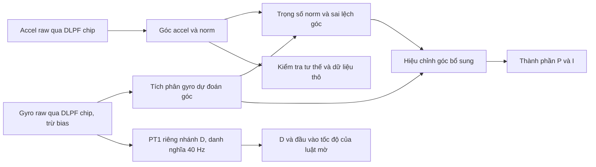

# Báo cáo thiết kế lọc ICM20602 — 03/11/2026

> Đây là thiết kế lọc nền03/11/2026. Bản05/11 bổ sung [ma trận gá và fusion vector3D](BAO_CAO_BU_LECH_LAP_IMU.md); trọng số nay dùng góc giữa hai vector, còn các phép tính PT1/DLPF giữ nguyên.

## 1. Mục tiêu và dữ liệu đã biết

ICM20602 không cung cấp DMP cho firmware này. ESP32 đọc raw accel/gyro, đổi đơn vị,
trừ bias rồi tự ước lượng góc. Chip vẫn có DLPF phần cứng; DLPF và DMP là hai chức
năng khác nhau. Hệ hiện tại đọc 200 Hz, I²C 100 kHz, gyro ±500°/s, accel ±4 g.

Người dùng xác nhận motor 17HS4401S và trọng tâm cao **0,025 m từ trục bánh**.
Chưa có log nhiễu IMU 200 Hz, phổ rung khi motor chạy, điện áp nguồn, đáp ứng MKS
hoặc mô-men quán tính thân xe. Vì vậy các thông số dưới đây là thiết kế khởi đầu
có tính toán, không phải tối ưu thực nghiệm.

## 2. Cấu trúc đã triển khai



Đường tích phân gyro không đi qua PT1 phần mềm mới. Điều này tránh cộng độ trễ
của PT1 vào toàn bộ góc dự đoán. Safety vẫn dùng gyro chưa lọc phần mềm và norm/tư
thế, không chỉ nhìn tín hiệu đã làm mượt.

## 3. Chọn DLPF đúng ICM20602

Theo bảng CONFIG và ACCEL_CONFIG2 của [TDK, trang 37–38](https://product.tdk.cn/system/files/dam/doc/product/sensor/mortion-inertial/imu/data_sheet/ds-000176-icm-20602-v1.1.pdf#page=37):

| Thiết lập | Gyro BW / noise BW | Accel BW / noise BW |
| --- | --- | --- |
| DLPF=2, cấu hình trước | 92 / 108,6 Hz | 99 / 121,3 Hz |
| DLPF=3, cấu hình mới | 41 / 59 Hz | 44,8 / 61,5 Hz |

Với fs=200 Hz, Nyquist=100 Hz. Mức 2 nằm gần Nyquist; chọn mức 3 làm điểm bắt đầu
để giảm nhiễu trước khi đọc/giảm tốc độ mẫu. Đây không phải bộ chống alias lý tưởng:
nhiễu cao tần đủ mạnh vẫn cần đo và xử lý cơ khí/nguồn/lấy mẫu phù hợp. Divider=4
cho nhịp 1000/(1+4)=200 Hz. Không lấy số group-delay 3,9/5,9 ms của sensor khác
gán cho ICM20602; bảng đang dùng không công bố group delay đó.

Không dùng thông số low-power averaging trong bảng khác như thể đó là thông số
DLPF low-noise hiện hành. Không thêm notch cố định khi chưa biết đỉnh rung.

Ước lượng sàn nhiễu lý tưởng bằng `sigma ≈ noise_density * sqrt(noise_BW)`:
với mật độ gyro0,004°/s/√Hz và accel100µg/√Hz trong datasheet, mức3 cho khoảng
0,0307°/s gyro và0,000784g accel. Đây là ước lượng từ thông số chip, không phải
STD của module trên xe. Rung motor, nguồn và cách lắp có thể lớn hơn nhiều; không
nhân tiếp hệ số giảm RMS PT1 như thể mẫu sau DLPF vẫn là nhiễu trắng độc lập.

## 4. PT1 nhánh D và chi phí độ trễ

Đối chiếu nguyên lý với [PX4 AlphaFilter](https://raw.githubusercontent.com/PX4/PX4-Autopilot/main/src/lib/mathlib/math/filter/AlphaFilter.hpp).
Mã riêng: `lib/estimation/LocThongThap.h`.

```text
tau = 1 / (2*pi*f_danh_nghia)
k = dt / (tau + dt)
y[n] = y[n-1] + k*(x[n]-y[n-1])
H(z) = k / (1 - (1-k)*z^-1)
```

Tại dt=0,005 s, f danh nghĩa=40 Hz: tau=3,978874 ms, k=0,556862724.
Do rời rạc hóa backward-Euler, điểm -3 dB thực là **27,472 Hz**, không phải 40 Hz.

| Tần số tín hiệu | Biên độ | Pha | Ý nghĩa |
| --- | --- | --- | --- |
| 5 Hz | khoảng -0,150 dB | -7,03° | Ít suy giảm tín hiệu chậm, vẫn có trễ |
| 10 Hz | khoảng -0,569 dB | -13,32° | Trễ pha tương đương khoảng 3,70 ms, chỉ riêng PT1 |
| 50 Hz | khoảng -5,864 dB | xem CSV | Biên độ còn khoảng 0,5091 |

DC group delay riêng PT1 khoảng 3,98 ms. Với nhiễu trắng độc lập giữa các mẫu,
tỉ lệ RMS ra/vào là sqrt(k/(2-k))=0,6212. Giả thiết trắng không mô tả đầy đủ rung
motor hoặc nhiễu đã qua DLPF; không được nhân con số này với mọi RMS thực đo.

Filter khởi tạo bằng mẫu đầu để tránh xung giả, tính k theo dt thực, reset theo
controller, từ chối NaN/Inf/tham số lỗi. Đặt cutoff=0 để bypass phục vụ so sánh.
Moving average dài không được thêm mặc định: SMA 5 mẫu tại 200 Hz đã có group
delay 10 ms, ngoài trễ chip/bus/motor.

## 5. Fusion và ảnh hưởng gia tốc khi di chuyển

Tau bổ sung vẫn 0,4 s; tần số hiệu chỉnh tương đương 0,3979 Hz. Tại dt5 ms,
beta tối đa=dt/(tau+dt)=0,012345679. **Tau=0,4 s không có nghĩa toàn bộ góc bị trễ
400 ms**, vì gyro dự đoán góc ở mỗi mẫu.

Chỉ kiểm tra norm accel chưa đủ: gia tốc ngang 3 m/s² tạo góc giả atan(3/g)=17,01°,
trong khi norm chỉ tăng 0,4486 m/s², vẫn nằm trong ngưỡng cũ ±2,5. Đó là lý do
phải xét thêm sai lệch giữa góc accel và góc dự đoán gyro.

Lấy cảm hứng từ [acceleration rejection của x-io Fusion](https://github.com/xioTechnologies/Fusion#acceleration-rejection),
firmware áp dụng trọng số một chiều:

```text
w_norm = clamp(1 - abs(norm-g)/2.5, 0, 1)
innovation = wrap_pi(theta_accel - theta_predict)
w_angle = clamp((0.25 - abs(innovation))/(0.25 - 0.08), 0, 1)
trust = w_norm * w_angle
theta = theta_predict + trust * dt/(tau+dt) * innovation
```

Sai lệch dưới 0,08 rad (~4,58°) chưa bị giảm theo góc; từ đó đến 0,25 rad (~14,32°)
giảm dần; lớn hơn bị loại khỏi hiệu chỉnh. Nếu trust<0,1 liên tục 0,5 s, estimator
báo lỗi và reset; app đang chạy sẽ dừng/giữ lỗi. Thuật toán không tự ép nhận lại
accel sai sau một thời gian dài như một cơ chế AHRS phục hồi khác.

Các ngưỡng này là giá trị thử. Gia tốc kéo dài nhỏ, bias gyro hoặc chuyển động 3D
có thể vẫn gây sai góc. Không bù gia tốc bằng lệnh STEP rồi coi đó là phép đo độc
lập: chuyển động bánh vẫn dựa trên giả thiết MKS bám xung. Bộ Kalman cũng cần mô
hình/Q/R được nhận dạng; chỉ đổi tên thuật toán không giải quyết được vấn đề này.

## 6. Ngân sách độ trễ và thang thời gian

Mô hình điểm khối lượng có cực không ổn định sqrt(g/h)=19,8057 rad/s và thời gian
đặc trưng sqrt(h/g)=50,49 ms khi h=0,025 m. Mô hình thực còn phụ thuộc quán tính
thân, bánh và motor; giá trị này chỉ là thang thời gian để tránh lọc quá chậm.

| Thành phần | Giá trị biết được | Cần đo thêm |
| --- | --- | --- |
| Chu kỳ đọc | 5 ms | Jitter/miss/overlap thực |
| Giữ lệnh lấy mẫu | Xấp xỉ nửa chu kỳ trong mô hình ZOH | Phụ thuộc tần số xét |
| Giao dịch 14 byte I²C | Tối thiểu khoảng153 clock: 1,53 ms@100k; 0,3825 ms@400k | Overhead, clock stretching và lịch task |
| PT1 D | Tính theo H(z), xem bảng/CSV | Đúng nếu dt gần cấu hình |
| DLPF chip | BW đã biết | Group delay thực |
| MKS/motor | Chưa có số đo | Độ trễ bám, thời gian đảo chiều, lực theo tốc độ |

ICM20602 hỗ trợ I²C 400 kHz, nhưng code vẫn giữ 100 kHz cho tới khi bus/pull-up/dây
được xác nhận. Không tăng bus chỉ để che lỗi đọc. Không cộng một “group delay cố
định” cho mọi tần số hoặc tuyên bố phase margin khi chưa có hàm truyền toàn xe.

## 7. Kiểm thử và quy trình tìm thông số cuối

Đã chạy `filter_motion_tests.cpp`: tín hiệu sine50Hz qua class thật có biên độ
0,509114; NaN không làm hỏng trạng thái; bypass/reset đúng; burst accel ngang
3 m/s² không kéo góc theo gia tốc; mất tin cậy kéo dài báo lỗi. Các test nền về
góc/tư thế/mô hình vẫn đạt. Đây là dữ liệu tổng hợp trên PC.

Cần thu dữ liệu raw ở đúng200Hz khi motor tắt và khi chạy dưới tải: timestamp,
ax/ay/az, gx/gy/gz, góc accel/ước lượng, innovation/trust, lệnh STEP và tốc độ suy
từ xung. Log console hiện5Hz chỉ dùng trạng thái, **không đủ tính phổ rung 50Hz**.
Cần chế độ ghi mẫu riêng hoặc buffer rồi xuất khi tắt motor; chưa có bộ ghi200Hz
trong phiên bản này. Giữ nguyên đường bảo vệ thô trong lúc đo.

Đánh giá độ lệch chuẩn khi đứng yên, phổ rung, đáp ứng bước và thời gian hồi phục.
So sánh cutoff D 0/30/40/50Hz và DLPF2/3 với cùng tải/nguồn, nhưng phải tính lại
độ trễ và đo đáp ứng. Chỉ thêm notch nếu có đỉnh rung rõ, ổn định và dưới Nyquist.

## 8. Tái tạo phép tính

```powershell
python tools/tinh_toan_loc_va_motor.py
```

Kết quả: [bảng tính](du_lieu_tinh_toan/KET_QUA_TINH_TOAN.md),
[đáp ứng lọc CSV](du_lieu_tinh_toan/dap_ung_loc.csv), [JSON](du_lieu_tinh_toan/bao_cao_so.json).
Đây là đầu ra tính toán từ config, không gắn nhãn thành log cảm biến.
