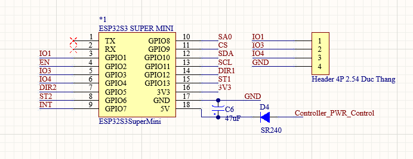
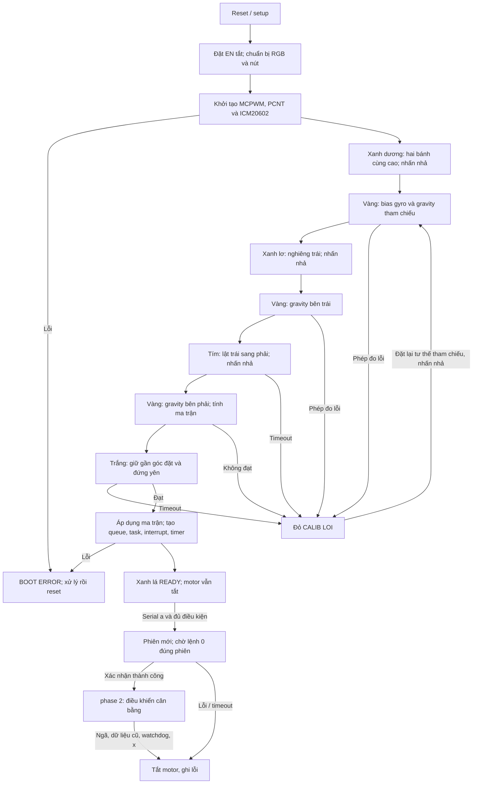

# Đối chiếu sơ đồ chân và luồng hiệu chuẩn — 05/11/2026

## Kết luận

Firmware đã được sửa theo sơ đồ ESP32-S3 Super Mini được cung cấp. Người dùng
xác nhận **motor 1 là bánh phải, motor 2 là bánh trái**. Luồng calib nay giữ
trục dọc đo từ chuyển động khung xe, nên không xóa góc pitch người đang giữ.
Góc cân bằng cơ học vẫn là thông số độc lập cần xác định trên xe thực.

Build `lolin_s3_mini` và năm nhóm kiểm thử native đã đạt. Chưa nạp/chạy trên xe;
kết quả phần mềm không xác nhận chiều motor, chất lượng tín hiệu hay ổn định cơ học.

## 1. Đối chiếu sơ đồ



**Cột “chân symbol” là số chân trên ký hiệu module trong ảnh, không phải số
GPIO và không phải số chân đóng gói chip ESP32-S3.** Tên biến firmware dùng số GPIO.

| Chân symbol module | Tên chân module | Net trong sơ đồ | Vai trò firmware |
| --- | --- | --- | --- |
| 1, 2 | TX, RX | Không nối trong ảnh | Không tự gán số GPIO từ ảnh này |
| 3 | GPIO1 | IO1 | Header dự phòng, chưa dùng |
| 4 | GPIO2 | EN | EN chung hai driver |
| 5 | GPIO3 | IO3 | Nút confirm calib |
| 6 | GPIO4 | IO4 | Header dự phòng, chưa dùng |
| 7 | GPIO5 | DIR2 | DIR bánh trái, motor 2 |
| 8 | GPIO6 | ST2 | STEP bánh trái, motor 2 |
| 9 | GPIO7 | INT | Data-ready ICM20602 |
| 10 | GPIO8 | SA0 | Chọn địa chỉ I²C |
| 11 | GPIO9 | CS | Chọn giao tiếp I²C |
| 12 | GPIO10 | SDA | SDA ICM20602 |
| 13 | GPIO11 | SCL | SCL ICM20602 |
| 14 | GPIO12 | DIR1 | DIR bánh phải, motor 1 |
| 15 | GPIO13 | ST1 | STEP bánh phải, motor 1 |
| 16 | 3V3 | 3V3 | Đường nguồn 3,3 V |
| 17 | GND | GND | Mass |
| 18 | 5V | Nhánh C6/D4 | Đường nguồn 5 V của module |

Header 4P: chân 1 = GPIO1; chân 2 = GPIO3; chân 3 = GPIO4; chân 4 = GND.
Trong hình, `Controller_PWR_Control` thuộc nhánh cấp nguồn qua D4 SR240 tới 5V;
không có đường nối từ net đó tới GPIO điều khiển trong đoạn sơ đồ này. Vì vậy
chưa thể coi nó là lệnh phần mềm cắt nguồn. Điện áp nguồn motor cũng chưa có
trong hình.

### Điểm đã sửa trong firmware

- SDA = 10; SCL = 11. Chỉ dẫn cũ SDA4/SCL10 không còn áp dụng.
- DIR/STEP trái = 5/6; phải = 12/13.
- CS GPIO9 được đặt HIGH; SA0 GPIO8 LOW với cấu hình địa chỉ `0x68`.
  Khi đặt địa chỉ `0x69`, code đặt SA0 HIGH.
- Driver thiết lập CS/SA0 trước `Wire.begin()`; kiểm tra `WHO_AM_I = 0x12`,
  reset rồi cấu hình bộ lọc và tần số mẫu.
- Thêm kiểm tra trùng chân lúc biên dịch qua `cacChanChucNangKhongTrung()`.
- PCNT và MCPWM cùng lấy các macro chân motor, nên phát và đếm STEP cùng đổi
  theo ánh xạ trái/phải mới.

ICM20602 chọn I²C khi CS HIGH; SA0 quyết định bit thấp của địa chỉ. Datasheet
cũng yêu cầu chú ý trạng thái chân khi cấp nguồn và điện trở kéo lên bus.
Firmware chỉ điều khiển được các chân sau khi ESP bắt đầu chạy; đoạn sơ đồ
chưa cho thấy điện trở kéo CS/SA0 và SDA/SCL. Cần kiểm tra phần mạch ICM còn lại.
[Datasheet ICM20602, mục 4.1 và 6](https://invensense.tdk.com/wp-content/uploads/2020/11/DS-000176-ICM-20602-v1.1.pdf)

### Các thông tin chưa xác minh bằng sơ đồ

| Thông tin | Cấu hình đang dùng | Cần kiểm chứng |
| --- | --- | --- |
| LED RGB | GPIO48, WS2812, GRB | Chân, loại LED, thứ tự màu trên đúng phiên bản board |
| Nút GPIO3 | Nhấn kéo xuống GND, pull-up nội | Mạch nút thực tế; ảnh chỉ thể hiện header |
| EN | Active LOW | Menu EN và mức tín hiệu MKS thực tế |
| Chiều tiến | DIR trái HIGH, phải LOW | Chiều lắp motor, dây pha, cấu hình chiều từng driver |
| Nguồn motor | Chưa biết | Điện áp thực, khả năng cấp dòng và sụt áp khi tăng tốc |

GPIO3 có vai trò strapping chọn nguồn JTAG tùy cấu hình eFuse. Hướng dẫn vận hành
là nhả nút khi cấp nguồn/reset, sau khi firmware vào UI mới nhấn.
[Datasheet ESP32-S3, Boot Configurations](https://www.espressif.com/sites/default/files/documentation/esp32-s3_datasheet_en.pdf)

## 2. Luồng khởi động, calib và arm



Nếu tắt `batUiCalib`, bỏ phần nút/LED và dùng ma trận từ
`ImuMountConfig.h`; vẫn đo bias gyro trước khi tạo task. Luồng mặc định là UI bật.

Ở các bước chờ xác nhận, firmware yêu cầu nhấn **và nhả** qua lọc dội 35 ms.
Bước trắng tự kiểm tra, không cần nút. Sau READY, LED chưa phản ánh trạng thái
runtime và nút chưa có xử lý arm/dừng; dùng Serial và telemetry.

`RobotApp::begin()` chuyển ma trận UI vào `ComplementaryEstimator`. Sau đó
IMU task lấy dữ liệu mới, Control task tính trạng thái/lệnh, Motor task sở hữu
driver. Cơ chế phiên chờ lệnh 0 tránh dùng lệnh cũ khi bật lại motor.
Xem [logic toàn chương trình](LOGIC_CHUONG_TRINH.md) và
[danh mục các hàm](DANH_MUC_HAM.md).

## 3. Tại sao tư thế người giữ không được lấy làm góc cân bằng?

Có ba đại lượng khác nhau:

1. **Bias gyro:** số lệch cảm biến khi vận tốc góc thật bằng 0.
2. **Ma trận lắp:** phép đổi vector từ hệ trục cảm biến sang hệ trục thân xe.
3. **Góc cân bằng cơ học:** góc đặt để trọng tâm nằm trên trục bánh trong mô hình tĩnh.

Khi đang đỡ xe, tay người tác dụng mô-men. IMU chỉ đo chuyển động và gia tốc
riêng; nó không đo trực tiếp mô-men tay hay vị trí trọng tâm. Vì vậy, chỉ giữ xe
yên rồi nhấn nút không đủ xác định góc cân bằng.

Cách dựng trục cũ ép Z theo vector gia tốc tham chiếu, rồi ép X vuông góc Z.
Nếu tư thế tham chiếu đang chúi trước một ít, phép dựng đó hấp thụ luôn độ chúi
vào “sai số lắp” và có thể báo pitch 0. Phần UI nay giữ X được đo từ chuyển
động khung, tránh nhầm lẫn này.

## 4. Tính toán ma trận từ lượt lật

Quy ước hệ thân: X hướng tiến, Y sang trái, Z lên trên. Lật từ trái sang phải
là quay roll dương quanh X. Các vector bên dưới viết trong hệ cảm biến;
gyro đã được trừ bias.

```text
M = sum(omega * transpose(omega) * dt)
q = sum(omega * dt)

X = eigenvector chính của M; chọn dấu để dot(X, q) > 0
u = normalize(a_tham_chieu)
Y = normalize(u × X)
Z = normalize(X × Y)

R = [ transpose(X)
      transpose(Y)
      transpose(Z) ]

a_than     = R * a_cam_bien
omega_than = R * omega_cam_bien
```

Đây là ma trận moment bậc hai không trừ trung bình; không được trừ trung bình
gyro trong lượt quay rồi bỏ mất tín hiệu quay gần đều. Code dùng 12 vòng power
iteration để tìm trục năng lượng chính, không lưu toàn bộ mẫu, phù hợp bộ nhớ MCU.

Với pitch ban đầu là β và roll tham chiếu α:

```text
a_tham_chieu / g = [-sin(β), cos(β) sin(α), cos(β) cos(α)]
pitch = atan2(-a_X, sqrt(a_Y² + a_Z²))
```

Phép dựng mới chỉ chọn hướng Y/Z quanh X, giữ nguyên a_X và độ lớn thành phần
vuông góc X. Vì vậy pitch sau đổi hệ vẫn là β, còn roll tại mốc tham chiếu là 0.
Ví dụ β = +6°, α = +4°: sau calib pitch vẫn +6°, roll mốc tham chiếu = 0°.

**Giới hạn quan sát:** một trục quay và gravity chưa đủ phân biệt sai số roll
của tư thế người giữ với góc gá quanh trục X. Nếu cần roll tuyệt đối chính xác,
dùng mặt chuẩn/đồ gá hoặc bổ sung thao tác quanh một trục thân độc lập đã biết.
PCA không chứng minh trục quay thật sự trùng X thân; thao tác lật lệch trục nhưng
rất đều vẫn có thể vượt kiểm tra năng lượng. Vì vậy cần giữ trục quay đúng bằng
cách đỡ/đồ gá, không chỉ dựa vào LED xanh.

Công cụ offline `HeTrucImu::tuHaiVector()` vẫn có cách dùng riêng: cần gravity
ở tư thế thân chuẩn đã biết và một vector hướng thứ hai. UI hiện không gọi
hàm đó để ép Z theo gravity người giữ. Xem
[báo cáo bù lệch lắp IMU](BAO_CAO_BU_LECH_LAP_IMU.md).

## 5. Ngưỡng và thời gian hiện hành

Các số dưới đây lấy từ code, là ngưỡng thiết kế ban đầu cần đối chiếu log xe.

| Kiểm tra | Giá trị | Diễn giải |
| --- | --- | --- |
| Tần số mẫu IMU | 200 Hz | Chu kỳ danh định 5 ms |
| Bias gyro | 500 mẫu | Danh định 2,5 s, thêm thời gian I/O/chờ |
| Mốc tĩnh | 80 mẫu, tối đa 2,5 s | Danh định 0,4 s, có thể lâu hơn theo polling/I²C |
| Đợi sau xác nhận mốc | 150 ms | Giảm rung do thao tác nút |
| Đứng yên | gyro ≤0,06 rad/s; norm accel lệch g ≤0,5 m/s² | Từ chối chuyển động/rung lớn |
| Phương sai accel tổng | ≤0,04 (m/s²)² | Áp dụng ba mốc tĩnh |
| Mẫu gyro chuyển động | 0,07–2,5 rad/s, dt >0 và ≤20 ms | Loại quá chậm/nhanh hoặc khoảng mẫu bất thường |
| Số mẫu chuyển động | ≥40 | Tối thiểu 0,2 s ở 200 Hz |
| Góc tổng | norm(q) ≥0,50 rad | Khoảng 28,65° |
| Năng lượng trên trục chính | ≥95% tổng | Giảm lượt lật lẫn nhiều trục |
| dot(X,u) | trị tuyệt đối ≤0,15 | Pitch mốc đầu ≤asin(0,15) ≈8,63° |
| Accel X ở hai đầu | trị tuyệt đối ≤1,70 m/s² | Pitch đầu/cuối khoảng ≤9,98° khi tĩnh |
| Roll trái / phải | [−1,75;−0,35] / [0,35;1,75] rad | Tối thiểu khoảng 20,05° mỗi bên; thao tác khuyến nghị 30–45° |
| Sai lệch góc gyro–hai mốc | ≤0,35 rad | Khoảng 20,05°, không phải tuyên bố độ chính xác 20° |
| Trắng: pitch so với góc đặt / roll | mỗi trị tuyệt đối ≤0,10 rad | Khoảng 5,73°, 80 mẫu tĩnh liên tiếp |
| Thời hạn tím / trắng | 30 s mỗi bước | Hết hạn báo CALIB LOI |

Trong bước đo bias, kiểm tra phương sai gyro giúp loại rung nhưng không chứng
minh xe đứng yên khi xe đang quay đều. Người dùng phải giữ cố định thân trong
toàn bộ bước vàng đo bias.

## 6. Góc cân bằng với trọng tâm cao 25 mm

Người dùng xác nhận `z = 0,025 m` tính từ trục bánh tới trọng tâm. Chưa có phép
đo xác nhận độ lệch trước/sau `x`; giá trị khai báo x = 0 không phải kết quả đo.

Với pitch θ dương chúi trước, tọa độ ngang của trọng tâm trong hệ đất là:

```text
x_dat = x cos(θ) + z sin(θ)
x_dat = 0  =>  θ_can_bang = -atan2(x, z)
```

| Độ lệch trọng tâm x giả định | Góc cân bằng với z = 25 mm |
| --- | --- |
| −2 mm (lệch về sau) | +4,574° |
| −1 mm | +2,291° |
| 0 mm | 0° |
| +1 mm | −2,291° |
| +2 mm (lệch về trước) | −4,574° |

Gần x = 0, độ nhạy khoảng −1/z = −40 rad/m, tương đương khoảng −2,292° mỗi mm.
Vì trọng tâm thấp, vài mm sai lệch đã tạo góc trim đáng kể. Công thức là mô hình
tĩnh trên nền ngang; chưa tính gia tốc, ma sát và sai số phân bố khối lượng.

`gocCanBang_rad` mặc định vẫn 0, không được UI ghi đè. Nếu đã đo x chính xác có
thể dùng công thức để chọn giá trị ban đầu rồi kiểm chứng. Không tự đổi sang
−4,574°: x = +2 mm chỉ là ví dụ tính toán.

## 7. MKS và ý nghĩa phản hồi bánh xe

Ánh xạ mới đi xuyên suốt phát STEP, đếm PCNT và động học hai bánh. Bộ đếm PCNT
đo xung đã phát tại chân ESP theo dấu DIR; nó không đọc encoder thật bên trong
MKS. Vòng kín bên trong driver giúp motor bám lệnh; quãng đường firmware suy ra
từ xung vẫn phụ thuộc motor bám đúng và bánh không trượt.

Do đó, motor kẹt hoặc bánh trượt không được phát hiện trực tiếp bằng số xung
PCNT. Không xem việc calib IMU thành công là kiểm chứng đường phản hồi cơ khí.
Xem [báo cáo MKS42C và động cơ](BAO_CAO_MKS42C_17HS4401S.md).

## 8. Kiểm chứng phần mềm và việc tiếp theo

| Hạng mục | Kết quả |
| --- | --- |
| Build `pio run -e lolin_s3_mini` | PASS; RAM 57.044 byte, flash 469.974 byte |
| Native control | PASS; 14.507 checks |
| Native watchdog | PASS; 19 checks |
| Native filter/motion | PASS; 169 checks |
| Native IMU mounting/vector | PASS; 3.114 checks |
| Native UI roll calibration | PASS; 25 điều kiện, gồm 6 tổ hợp pitch ±6° và roll tham chiếu −4°/0°/+4° |
| Kiểm tra sơ đồ ↔ macro ↔ MCPWM/PCNT | Mapping nhất quán, kiểm tra trùng chân lúc biên dịch |
| Thử board / oscilloscope / xe thực | Chưa thực hiện |

Bản ghi số liệu và SHA-256 firmware:
`docs/du_lieu_tinh_toan/PHIEN_KIEM_THU_UI_CALIB.json`. Các bản ghi kiểm thử trước đó
được giữ riêng để không nhầm kích thước firmware cũ với bản đã sửa UI này.

Test mới kiểm tra pitch đầu vẫn giữ nguyên và trục dọc không bị gravity mốc đầu
xoay lệch. Đây là dữ liệu tổng hợp; chưa đo độ chính xác trên PCB thực hay kiểm
thử tương tác nút/LED trực tiếp. Build dùng cấu hình PlatformIO hiện tại, không
xác nhận mọi biến thể Super Mini có cùng flash, USB và LED.

Thứ tự thực hiện tiếp: xác minh LED/nút → chạy calib khi motor bị khóa →
xem đúng dấu pitch/roll → kiểm chứng DIR/EN/vi bước và xung → chỉnh góc đặt/PID
trên giá thử → mới thử di chuyển. Quy trình thao tác chi tiết nằm trong
[hướng dẫn UI_Calib](HUONG_DAN_UI_CALIB.md).

