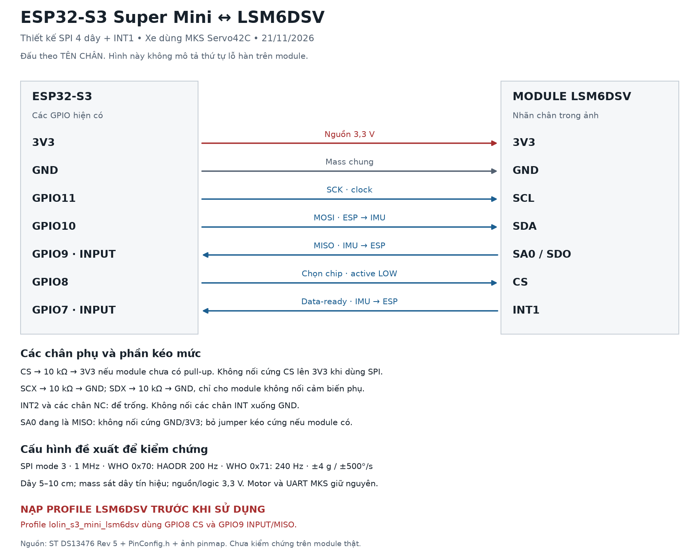

# Thiết kế kết nối LSM6DSV với ESP32-S3 Super Mini trên xe MKS

Profile PlatformIO **`lolin_s3_mini_lsm6dsv`** dùng SPI 4 dây cho xe MKS.
Profile **`lolin_s3_mini`** dùng ICM20602 qua I²C. Mỗi firmware chọn một cảm biến trước khi khởi tạo GPIO.

## Phương án chọn: SPI 4 dây và ngắt data-ready

Theo pinmap ngày 21/11, thứ tự **SCK, MOSI, MISO, CS, INT1** là **11, 10, 9, 8, 7**.
Mạch MKS hiện dùng GPIO1/3/4 cho UART, GPIO2 cho EN,
GPIO5/6/12/13 cho DIR/STEP; không có chân nào trùng với nhóm IMU này.

Sơ đồ theo TÊN CHÂN in trên module trong ảnh người dùng cung cấp. Không dùng
thứ tự trái/phải trong ảnh để suy ra chân khi lật module. Thiết kế này áp dụng
cho module sáu trục LSM6DSV, không mặc định cho bản có gắn thêm từ kế ở SCX/SDX.

## Đấu dây chính

- `ESP 3V3` → `module 3V3`.
- `ESP GND` → `module GND`.
- `ESP GPIO11` → `module SCL`: clock SPI SCK.
- `ESP GPIO10` → `module SDA`: dữ liệu ESP gửi, MOSI/SDI.
- `ESP GPIO9` ← `module SA0`: dữ liệu IMU trả, MISO/SDO khi dùng SPI 4 dây.
- `ESP GPIO8` → `module CS`: chọn chip, tích cực mức thấp.
- `ESP GPIO7` ← `module INT1`: ngắt báo có mẫu mới.

Nguồn và logic đều 3,3 V. Không cấp 5 V vào chân ghi `3V3` trên module.
Đã có ICM bị hỏng: trước khi lắp module mới cần đo lại rail 3,3 V và kiểm tra
không có dây tín hiệu bị nối nhầm nguồn. Chỉ thay dây/module khi đã ngắt nguồn.

## Chân phụ và linh kiện

- `INT2`: để trống, không nối GND hoặc 3V3.
- Các chân ghi `NC`: để trống.
- `SCX` và `SDX`: đây là bus phụ, KHÔNG phải SDA/SCL giao tiếp với ESP.
  Với module sáu trục không nối cảm biến phụ, kéo mỗi chân xuống GND bằng
  một điện trở 10 kΩ để xác định mức khi bus phụ không sử dụng. Nếu module đã
  có điện trở kéo thì kiểm tra sơ đồ/đo thông mạch trước, không nối thêm tùy ý.
  Không áp dụng cách kéo này cho bản có từ kế nối sẵn vào SCX/SDX.
- `CS`: thêm điện trở 10 kΩ từ CS lên 3V3 nếu module chưa có. CS do GPIO8
  điều khiển; KHÔNG nối cứng CS lên 3V3 trong phương án SPI.
- `SA0`: KHÔNG nối cứng GND/3V3 vì đang là ngõ ra MISO. GPIO9 phải là ngõ vào.
  Nếu có jumper trên module nối cứng SA0 hoặc CS, phải cấu hình lại jumper
  theo sơ đồ module trước khi dùng SPI.
- Giữ tụ gốm decoupling trên module. Có thể thêm 1 µF đến 4,7 µF giữa 3V3/GND
  tại đầu cáp nếu đường cấp nguồn dài; không thay tụ decoupling sát IC bằng tụ ở ESP.

Đề xuất dây dài 5–10 cm, mass đi sát nhóm clock/data và tách khỏi dây motor.
Nếu làm bo chuyển, có thể chừa footprint điện trở nối tiếp 22–33 Ω trên SCK,
MOSI và CS tại đầu phát ESP; giá trị cuối phụ thuộc cạnh tín hiệu thực tế.

## Chọn firmware và chỉnh cấu hình

| Hạng mục | Profile LSM6DSV |
|---|---|
| Build firmware tại thư mục gốc | `pio run -e lolin_s3_mini_lsm6dsv` |
| Build lại firmware ICM20602 cho xe MKS | `pio run -e lolin_s3_mini` |
| Chân, SPI, ODR, dải đo, LPF phần cứng | [Lsm6dsvConfig.h](../include/config/Lsm6dsvConfig.h) |
| PID, vòng vận tốc, bộ lọc góc, lọc D, ngưỡng tin gia tốc, hướng lắp | [Lsm6dsvTuning.h](../include/config/Lsm6dsvTuning.h) |
| Giá trị lưu qua `save` và `c` | NVS `xe_lsm6dsv` trên LSM, `xecanbang` trên ICM |

Bản LSM dùng SPI mode 3, MSB first, **1 MHz**, ±500°/s và ±4 g. Driver chọn cách giải mã và nhịp mẫu theo `WHO_AM_I` ở thanh ghi `0x0F`:

- `0x70` chọn nhánh LSM6DSV, HAODR **200 Hz** (chu kỳ danh nghĩa 5 ms).
- `0x71` chọn nhánh tương thích LSM6DSV16BX, high-performance **240 Hz** (khoảng 4,17 ms). Với 16BX, các thanh ghi gia tốc được xuất theo thứ tự Z, Y, X và firmware sắp lại thành X, Y, Z.

Driver đọc lại cấu hình, đo nhịp 32 mẫu mới rồi mới vào hiệu chuẩn. INT1 báo mẫu gyro sẵn sàng. Task xuất khung khi gyro và accel đều có dữ liệu mới, còn hạn và có timestamp từ ngắt. Bản LSM dùng cho xe MKS vì GPIO8/9 là đường encoder ở cấu hình TMC_MT.

PID góc khởi đầu `33 / 0 / 3.3`, vòng vận tốc `0.15 / 0.06`. Các số này là mốc thử từ ICM, kết quả cho LSM sẽ cần đo trên xe. Các lệnh chỉnh PID, `save`, `resetcfg` và `status` áp dụng trên profile đang chạy. Thông số trong NVS đã lưu được ưu tiên so với mặc định trong mã. `status` in tên IMU, bus, tốc độ SPI, ODR, NVS và trạng thái ma trận lắp. CSV/radio giữ tên cột `i2c`/`imu_i2c` cho các công cụ hiện có; với LSM, bộ đếm đó ghi lỗi đọc bus SPI.

## Khởi động và hiệu chuẩn khi có module

1. Nạp environment `lolin_s3_mini_lsm6dsv` khi module đã tách khỏi bộ dây cũ. Ngắt toàn bộ nguồn trước khi đấu lại dây. Driver LSM dùng GPIO8 điều khiển CS và GPIO9 làm đầu vào MISO.
2. Giữ motor tắt, mở Serial USB ở 115200. Kiểm tra `LSM_BOOT PASS`, `WHO=0x70` hoặc `WHO=0x71` cùng nhịp tương ứng. Sau `READY` dùng `status` để kiểm tra profile và góc tham chiếu đang áp dụng.
3. Với cách gá hiện tại, **−X trên module hướng về đầu xe**. Giữ xe đứng yên đúng tư thế cân bằng, hai bánh cùng cao và motor tắt. Chọn **Calib 2s (c)** trong WebUI hoặc gửi `c`. Lần đầu, firmware dùng phương trọng lực và hướng tiến đã khai báo để dựng hệ trục, lấy tư thế này làm 0° và đo bias gyro. Sau khi có ma trận đã lưu, `c` đo lại bias và góc cân bằng. Nếu gá lại module, dùng `cal1 -x` (thay `-x` bằng trục thật sự hướng về đầu xe) để dựng lại ma trận. Khi chưa biết hướng trục và muốn đo bằng chuyển động, dùng `cal3 start` và làm theo hướng dẫn ba tư thế.
4. Khi motor tắt, nghiêng đầu xe nhẹ về trước. Góc dọc so với tư thế đứng phải tăng, tốc độ góc dọc dương **trong lúc hạ** và trở về gần 0 khi giữ yên. Làm ngược lại khi hạ đuôi. Kiểm tra gia tốc đứng yên xấp xỉ 1 g, nhịp theo ID và bộ đếm lỗi. Nếu dấu sai, giữ motor tắt và kiểm tra hướng lắp/các mốc hiệu chuẩn.

Firmware `lsm-cal1-20261121` lưu ma trận gá lắp, mã WHO và góc cân bằng trong cùng bản ghi `mount_lsm_v1`. Sau khi nâng cấp từ firmware dùng khóa `mount`, hoặc sau khi thay chip có WHO khác, cấu hình mặc định khóa motor chờ hiệu chuẩn. Các hệ số PID đã lưu trong `xe_lsm6dsv` vẫn được nạp. Những lần bật nguồn sau, xe đọc lại ma trận và đo mới bias gyro khi đứng yên.

## Thời gian truyền tính trên dây

Một burst 14 byte accel/gyro/nhiệt độ cộng 1 byte địa chỉ:

- SPI 1 MHz: 15 × 8 / 1 MHz = 120 µs.
- SPI 4 MHz: 15 × 8 / 4 MHz = 30 µs.
- I²C 400 kHz: khoảng 17 × 9 / 400 kHz = 382,5 µs cho cùng lượng dữ liệu.

Đây chỉ là phép tính giao dịch, không bao gồm driver, lập lịch, đọc status hay
độ trễ bộ lọc bên trong cảm biến. Không diễn giải thành mức giảm rung hoặc độ
trễ vòng điều khiển đã đo. 

## Sơ đồ tham khảo nếu thiết kế I²C riêng

Với nhóm GPIO mới, dùng GPIO10→SDA, GPIO11→SCL, GPIO7←INT1. CS phải giữ mức cao; SA0 kéo thấp
để chọn địa chỉ `0x6A` (kéo cao là `0x6B`). Thêm một bộ pull-up SDA/SCL về 3V3
nếu module chưa có; chọn theo điện dung và tốc độ bus, bắt đầu kiểm tra ở
400 kHz với dây ngắn. Không đấu đồng thời sơ đồ kéo cứng SA0 này với MISO SPI.
Firmware `lolin_s3_mini_lsm6dsv` triển khai SPI. Sơ đồ I²C này cần một driver I²C riêng.

## Kiểm chứng trước khi bật cân bằng

Ngày 17/11/2026, ba environment `lolin_s3_mini`, `lolin_s3_mini_tmc_mt` và
`lolin_s3_mini_lsm6dsv` đã build thành công. Bộ native test của dự án đã qua.
Kiểm thử SPI giả lập xác nhận cấu hình, nhịp mẫu, scale, mẫu thiếu/chồng, lỗi ID,
mất kết nối và hiệu chuẩn. Mã C ST tại commit được ghi dưới đây đã được biên dịch
để đọc lại register image từ driver mới và đối chiếu hệ số đổi đơn vị.
Phép kiểm chứng này thực hiện trên máy tính. Để xác nhận bản đang chạy, cần log khởi động và số đo góc khi motor tắt.

Kiểm tra nguồn và jumper; đọc ID/cấu hình khi motor tắt; ghi nhịp data-ready,
mẫu mất/chồng, thời gian đọc, norm gia tốc khi đứng yên và gyro sau trừ bias.
Sau đó kiểm trục/dấu và thử đứng cân bằng có người đỡ. Không tuyên bố ổn định
hoặc hết rung từ riêng thiết kế đấu dây này.

## Nguồn đối chiếu

- [LSM6DSV datasheet ST, DS13476 Rev 5](https://www.st.com/resource/en/datasheet/lsm6dsv.pdf):
  bảng chân, SPI mode 0/3, timing, HAODR, ngắt và WHO_AM_I.
- [Định nghĩa thanh ghi của ST cho LSM6DSV16BX](https://github.com/STMicroelectronics/lsm6dsv16bx-pid/blob/master/lsm6dsv16bx_reg.h).
- [Driver C của ST tại commit đã đối chiếu](https://github.com/STMicroelectronics/lsm6dsv-pid/tree/ba9ea4ea331184416c0be47616e64a51200f0c23). Tuỳ chọn `-StDriverRoot` trong `test/run_native.ps1` dùng trực tiếp mã C tại checkout này để đọc lại cấu hình do firmware ghi trên bus giả lập.
- `include/config/PinConfig.h`, `include/config/MotorConfig.h`,
  `lib/imu/src/Icm20602Driver.cpp` và sơ đồ
  `docs/images/so_do_chan_esp32s3_supermini.png` trong dự án hiện tại.
- Ảnh pinmap module do người dùng cung cấp ngày 17/11/2026. Chưa có sơ đồ
  mạch điện hoặc đo thông mạch của chính module để xác nhận điện trở/jumper sẵn có.
