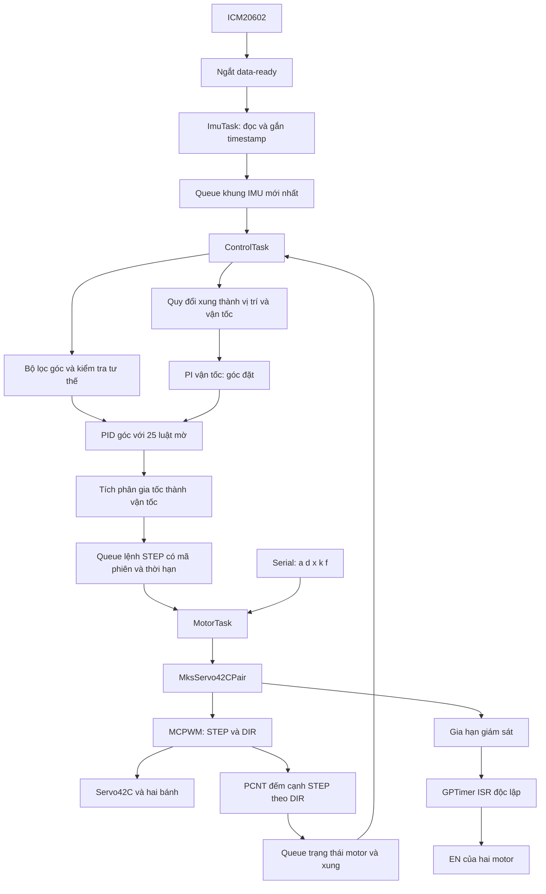
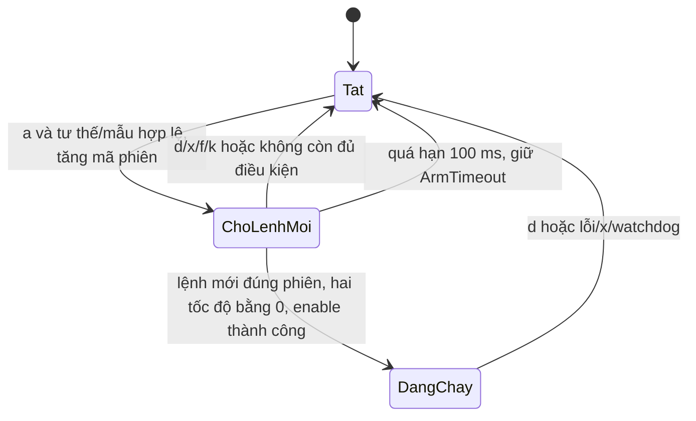

# Logic toàn bộ chương trình xe cân bằng

> Cập nhật lọc và di chuyển 03/11/2026: [ICM20602](BAO_CAO_ICM20602_LOC_NHIEU.md), [MKS42C/17HS4401S](BAO_CAO_MKS42C_17HS4401S.md). Runtime không DMP; PT1 chỉ nhánh D; có lệnh di chuyển có hạn; R01 đã sửa.

Đối chiếu lại mã nguồn ngày **05/11/2026**. Trạng thái kiểm chứng và việc còn mở:
[checklist](CHECKLIST_TINH_NANG.md), [báo cáo rà soát](KET_QUA_RA_SOAT_2026-11-03.md).

Tài liệu này mô tả mã đang chạy từ `src/main.cpp`, sau các sửa lỗi giám sát motor,
tư thế IMU, đồng bộ bật lại và thông báo ngắt trùng. Tên biến mới dùng tiếng Việt
không dấu. Các hệ số điều khiển/ngưỡng thử cần được xác nhận trên xe thật.

Đọc theo thứ tự: tài liệu này → [danh mục từng hàm](DANH_MUC_HAM.md) →
[hướng dẫn sửa và kiểm thử](HUONG_DAN_SUA_VA_KIEM_THU.md).
[Hướng dẫn nhập môn](HUONG_DAN_LAP_TRINH.md) giải thích con trỏ, tham chiếu và đọc I²C.

> Bổ sung05/11/2026: [hệ trục và ước lượng vector](BAO_CAO_BU_LECH_LAP_IMU.md) thay phần chọn trục/tích phân pitch1D; các task và luồng motor giữ vai trò đã mô tả.

## 1. Xe đang điều khiển điều gì?

ICM20602 đo gia tốc/tốc độ góc. Bộ lọc ước lượng góc thân xe. Bộ PID góc tạo gia tốc
bánh cần thiết để đỡ thân. Gia tốc được tích phân thành vận tốc, rồi đổi sang số
xung STEP mỗi giây. MKS Servo42C nhận STEP/DIR ở chế độ `CR_vFOC` và tự bám vị trí
bằng encoder nội bộ. ESP32 đếm chính cạnh STEP đã phát để ước lượng chuyển động bánh.

Vì vậy, phần mềm biết số xung tại GPIO ESP32; giả thiết cơ khí là motor bám xung,
tỉ số truyền đúng và bánh không trượt. Không có UART đọc encoder MKS trong firmware này.
Khi motor tắt hoặc bánh bị đẩy/trượt, số xung không mô tả đầy đủ chuyển động thực.

Vòng ngoài PI vận tốc đưa vận tốc ước lượng về `vanTocDat_mps` (mặc định 0) bằng cách
điều chỉnh góc đặt. Đã có mục tiêu tiến/lùi/quay có hạn qua Serial; chưa giữ vị trí/hướng tuyệt đối.



## 2. Bản đồ source

| Nơi chứa | Công việc |
| --- | --- |
| `src/main.cpp` | Tạo `xeCanBang`; Arduino gọi `setup()` và `loop()` |
| `src/app/RobotApp.*` | Ghép các module, tạo task/queue/timer, nhận lệnh Serial |
| `src/calib/UI_Calib.*` | UI nút/RGB chạy đồng bộ trong setup, đo bias và thu lượt lật trái–phải |
| `lib/estimation/HieuChuanQuayNgang.*` | Tìm trục dọc khung từ gyro, dựng và kiểm tra ma trận gá cho UI |
| `lib/estimation/HeTrucImu.*` | Kiểm tra ma trận và đổi vector từ hệ sensor sang hệ xe |
| `src/core/PhienCanBang.h` | Quản lý tắt → chờ lệnh mới → chạy; chống dùng lại lệnh cũ |
| `src/core/BoLocThuTuMau.h` | Nhận mẫu mới một lần, đếm bỏ lỡ/trùng và xử lý số thứ tự quay vòng |
| `src/safety/SafetyMonitor.*` | Quyết định mẫu có dùng được không, xe có ngã không, có được bật không |
| `lib/imu/src/Icm20602Driver.*` | Giao tiếp I²C, cấu hình ICM20602, đọc mẫu, hiệu chuẩn gyro |
| `lib/estimation/ComplementaryEstimator.*` | Ước lượng góc dọc; cung cấp góc ngang/độ lớn gia tốc cho bảo vệ |
| `lib/kinematics/DifferentialDrive.*` | Quy đổi vận tốc ↔ STEP/s, quãng đường và vận tốc từ số đếm |
| `lib/controllers/AnglePidController.*` | PD/PID góc, luật mờ và giới hạn gia tốc |
| `lib/controllers/CascadeController.*` | Ghép PI vận tốc, PID góc, tích phân vận tốc lệnh |
| `lib/motor_drv/src/MksServo42C.*` | Quản lý hai bánh, DIR, xung thưa/liên tục, hạn lệnh và lỗi |
| `lib/motor_drv/src/McpwmStepOutput.*` | Phát xung một chân STEP bằng phần cứng |
| `lib/motor_drv/src/WheelPulseCounter.*` | Hai bộ PCNT đếm STEP có dấu theo DIR |
| `lib/motor_drv/src/GiamSatDongCo.*` | Sở hữu việc bật EN; ISR được tắt EN khi quá hạn |
| `include/model/` | Những cấu trúc dữ liệu được truyền giữa module |
| `include/config/` | Chân, cơ khí, cảm biến, motor, PID và các giới hạn |
| `test/native/` | Kiểm thử trên PC; watchdog dùng driver giả để gọi mã giám sát thật |

Các file `src/tasks/*.cpp`, `RobotCore.*`, `Logger.*`, `IController.h`,
`IStateEstimator.h`, `IMotorOutput.h`, `ControlCommand.h`, `KalmanEstimator.*` hiện
là khung rỗng. Chức năng task thực tế nằm trong `RobotApp.cpp`; góc dùng bộ lọc bổ sung.
`BoardConfig.h` và `ProjectConfig.h` chưa có tham số hoạt động. Không cần điền các
file khung này để firmware hiện tại chạy; nếu tách module sau này, chuyển code có kiểm thử.

## 3. Các dữ liệu cần hiểu trước

| Kiểu | Trường chính | Ý nghĩa |
| --- | --- | --- |
| `KhungDuLieuImu` | `thoiDiemLayMau_us`, `soMauLayDuoc` | Timestamp/số thứ tự ngắt tương ứng mẫu ICM20602; kiểu IMU hiện hành, alias MPU dành cho bench |
| | `giaTocX/Y/Z_mps2`, `tocDoGocX/Y/Z_radps` | Gia tốc gồm trọng lực; gyro đã đổi đơn vị và trừ bias khi đã hiệu chuẩn |
| | `daHieuChinhConQuay`, `trangThai` | Điều kiện chất lượng trước khi lọc góc |
| | `soMauBoLo`, `soThongBaoTrung`, `soLanDocChongNgat` | Thống kê luồng ngắt/đọc I²C |
| `TrangThaiXe` | `gocNghien_rad`, `tocDoNghien_radps` | Góc dọc và tốc độ nghiêng phục vụ PID |
| | `gocNghiengNgang_rad`, `tocDoNghiengNgang_radps` | Tư thế ngang/tốc độ quay ngang phục vụ bảo vệ |
| | `doLonGiaToc_mps2`, `giaTocTinCay` | Chặn dữ liệu bất thường; yêu cầu tin cậy khi bật |
| | `viTriDoc_m`, `vanTocDoc_mps`, `nguonQuangDuong` | Chuyển động ước lượng từ xung; nguồn là `XungBuoc` |
| | Hai timestamp và ba cờ hợp lệ | Tách tuổi mẫu góc với tuổi mẫu xung |
| `WheelPulseFrame` | `trai`, `phai`, `thoiDiem_us`, `hopLe` | Tổng cạnh STEP có dấu 64 bit và thời điểm đọc PCNT |
| `WheelStepCommand` | Hai tốc độ bước, thời điểm ra lệnh/hết hạn | Lệnh STEP/s có dấu; không được đổi timestamp cũ để kéo dài lệnh |
| `MotorStatus` | Snapshot driver, khung xung, lỗi, chế độ mờ, `maPhien`, `cheDo` | MotorTask gửi sang ControlTask/console |
| `ControlStatus` | Trạng thái xe, lệnh, lỗi, hệ số PID, `maPhien`, `soThuTuLenh` | ControlTask gửi sang MotorTask/console |

`maPhien` phân biệt lần bật/tắt, còn `soThuTuLenh` phân biệt các lệnh liên tiếp
trong phiên. Chúng giải quyết hai việc khác nhau. Bốn queue ở đây dài 1: bên đọc
lấy bản mới nhất, không phát lại cả danh sách lệnh cũ khi task bị chậm.

## 4. Trình tự khởi động

1. `setup()` gọi `xeCanBang.begin()`; Serial khởi tạo ở 115200 baud.
2. Đưa EN về mức tắt, khởi tạo nút/RGB nếu `batUiCalib=true`. Kiểm tra nhịp cấu hình.
3. `MksServo42CPair::begin()` chuẩn bị DIR, hai MCPWM và GPTimer giám sát.
   Giám sát chạy nhưng chưa arm, nên không phát lỗi timeout khi xe đang tắt.
4. `WheelPulseCounter::begin()` nối input path của chính GPIO STEP/DIR vào PCNT.
5. `Icm20602Driver::begin()` đặt CS GPIO9 lên HIGH, SA0 GPIO8 xuống LOW cho địa chỉ
   `0x68`, mở I²C SDA10/SCL11, kiểm tra ID `0x12`, reset, cấu hình và đọc lại thanh ghi.
6. Nếu UI bật, `UI_Calib::chay()` chờ xác nhận tư thế tham chiếu, đo bias bằng 500
   mẫu đứng yên, lấy mốc trái, thu lượt lật trái–phải, lấy mốc phải và dựng ma trận.
   LED trắng yêu cầu giữ yên gần `gocCanBang_rad`; sau đó app truyền ma trận vào
   estimator. UI lỗi thì giữ EN tắt và chờ nhấn nhả để làm lại. Nếu UI tắt, app dùng
   ma trận `ImuMountConfig.h` và chỉ chạy `hieuChinhConQuay(500)`.
7. Tạo bốn queue (IMU, motor, điều khiển, di chuyển) và các task. Gửi trạng thái motor ban đầu: tắt, phiên 0.
8. Gắn ngắt ICM; tạo `esp_timer` để đánh thức MotorTask mỗi 250 µs.
9. Bỏ các byte Serial đã chờ trong lúc calib, đặt `_daSanSang = true`, sáng xanh lá
   và in READY. Xe vẫn tắt cho đến yêu cầu `a` hợp lệ. Nút calib không dùng để arm.

UI giữ trục X đo từ chuyển động khung: `Y = normalize(g_ref × X)`, `Z = X × Y`,
các hàng ma trận là X/Y/Z. Nhờ đó pitch lúc người giữ không bị đặt bằng 0. Roll 0
vẫn theo tư thế tham chiếu, nên đặt hai bánh cùng độ cao. `gocCanBang_rad` là góc
cân bằng cơ học riêng và không được UI tự ghi. Ma trận UI chỉ tồn tại trong RAM.
Xem [quy trình chi tiết](HUONG_DAN_UI_CALIB.md) và
[phân tích sơ đồ/tư thế tham chiếu](DOI_CHIEU_SO_DO_VA_FLOW_CALIB.md).

Lỗi trước khi tạo task trả `false` và giữ EN tắt. Lỗi tạo task/timer đi qua
`cleanupStartup()` để tháo ngắt, dừng timer, xóa task/queue. `main.cpp` không thử
khởi tạo lại tự động. Lỗi khởi động cần sửa nguyên nhân rồi reset board.

## 5. Ai chạy lúc nào? Ai được sửa dữ liệu?

| Thành phần | Nhịp/ưu tiên | Việc được làm |
| --- | --- | --- |
| ISR ICM | Data-ready ~200 Hz | Ghi timestamp/số thứ tự dưới khóa, gửi notification |
| ImuTask | Ưu tiên 4, chờ notification | Chủ duy nhất của I²C sau khởi động; đọc và gửi frame |
| ControlTask | Ưu tiên 3, theo frame mới | Chủ của estimator/odometry/controller |
| MotorTask | Ưu tiên 5, mục tiêu 250 µs | Chủ của driver motor và PCNT, quyết định phiên chạy |
| `motorTimer()` | Callback trong task `esp_timer` | Chỉ gửi bit đánh thức MotorTask |
| `khiBaoThuc()` | GPTimer ISR, chu kỳ 250 µs | Kiểm tra hạn, tắt EN và giữ lỗi; không gọi MCPWM/Serial/I²C |
| Arduino `loop()` | Console | Nhận phím, gửi bit lệnh, in bản sao trạng thái mỗi 200 ms |

Khóa `_khoaDuLieuNgatImu` bảo vệ timestamp 64 bit và số thứ tự ngắt như một cặp.
Khóa trong `GiamSatDongCo` bảo vệ cả deadline, cờ lỗi và thao tác EN. Không giữ
khóa qua I²C, Serial hay thao tác cấp phát tài nguyên. Các task chưa ghim core thủ
công; phải đo timing thực tế, không suy từ chu kỳ timer rằng lịch chạy luôn chính xác.

## 6. Một mẫu đi qua chương trình thế nào?

ImuTask nhận thông báo rồi chụp cặp thời gian/số thứ tự. `BoLocThuTuMau::chapNhan()`
bỏ thông báo lặp mà không xuất frame lỗi. Driver đọc burst I²C. Nếu số thứ tự ngắt
thay đổi trong lúc đọc, task bỏ mẫu vì timestamp chưa chắc khớp và đọc mẫu mới ở
lượt tiếp theo. Timeout 20 ms hoặc lỗi I²C xuất frame không hợp lệ.

ControlTask đọc frame và snapshot xung mới nhất. Bộ lọc kiểm tra số hữu hạn, bias,
timestamp, độ lớn gia tốc. Dữ liệu toàn 0 có độ lớn gia tốc 0 nên bị từ chối.
Ngưỡng cứng hiện là 2–30 m/s²; miền tin cậy để khởi tạo/arm là gần 9,80665 ±2,5 m/s².

`HeTrucImu` dùng R cố định để đưa accel và gyro từ hệ sensor sang hệ xe. R được
kiểm tra trước khi app khởi động; tư thế lúc bật nguồn không được dùng để đổi R.
Góc dọc từ gia tốc là `atan2(-aX, hypot(aY,aZ))` sau phép quay. Estimator truyền
vector phương đứng bằng Rodrigues(-omega*dt), hiệu chỉnh theo norm/góc giữa hai
vector, rồi lấy pitch và tốc độ pitch theo quan hệ Euler. Roll bảo vệ vẫn dựa
trên accel ở hệ xe. Chi tiết, giới hạn và ví dụ số có trong báo cáo bù gá mới.

Odometry tính `soXungTrungBinh = (deltaTrai + deltaPhai) / 2`, nhân quãng đường mỗi
xung để được dịch chuyển, chia `dt` để được vận tốc, rồi lọc bậc một với `tau=0,03 s`.
Mẫu xung đầu tiên chỉ có vị trí; cần mẫu thứ hai mới có vận tốc hợp lệ.

`SafetyMonitor::check()` kiểm tra dữ liệu/tuổi mẫu/góc dọc-ngang. Nếu lỗi, controller
reset và báo lỗi để MotorTask dừng. Nếu hợp lệ, ControlTask tạo lệnh và gắn mã phiên
đã đọc; MotorTask kiểm tra lại tuổi mẫu tại thời điểm thực sự sử dụng lệnh.

## 7. PID mờ và vòng vận tốc

Chu kỳ góc theo mẫu IMU. Chu kỳ PI vận tốc mục tiêu 20 ms, được tích lũy bằng thời
gian thực giữa các lần chạy. Vòng vận tốc:

```text
saiLechVanToc = vanTocDat - vanTocUocLuong
gocDat = gocCanBang + gioiHan(Kp_v * saiLechVanToc + Ki_v * tichPhanVanToc)
```

Vòng góc sử dụng quy ước dấu đã chọn cho xe:

```text
saiLechGoc = gocNghien - gocDat
giaTocLenh = Kp * saiLechGoc + Ki * tichPhanGoc + Kd * tocDoNghien
vanTocLenh = gioiHan(vanTocLenh + giaTocLenh * dt)
tanSoStep = vanTocLenh / quangDuongMoiXung
```

Nghiêng trước dương phải làm bánh tăng tốc tiến để đỡ thân. D lấy từ gyro để tránh
xung đạo hàm khi góc đặt thay đổi. Đầu vào mờ thứ hai cũng là gyro; khi góc đặt đang
đổi, nó không hoàn toàn bằng đạo hàm sai lệch.

Mỗi đầu vào mờ chuẩn hóa về [-1,1], có 5 tập NB/NS/Z/PS/PB. Hai độ thuộc nhân nhau
tạo trọng số của một trong 25 luật. Ba bảng cho hệ số nhân Kp/Ki/Kd, giải mờ bằng
trung bình có trọng số. Hệ số cơ sở hiện là 30/0/3; Ki=0 nghĩa đang thử PD mờ.
`f` khi tắt cho phép so sánh với hệ số cố định. Đây là bảng luật thiết kế ban đầu,
không phải quá trình học tự động hoặc kết quả tối ưu từ dữ liệu thực.

Gia tốc chặn ±3 m/s²; vận tốc chặn theo trần 10000 STEP/s, tương đương khoảng
0,393 m/s với cấu hình hiện tại. PI có chống tích lũy khi góc đặt chạm trần. PID
chặn phần tích phân làm tăng bão hòa nhưng cho xả theo hướng thoát trần. Khi bật Ki khác0,
cần kiểm tra riêng quá trình thoát bão hòa; bộ test mặc định dùng Ki=0.

## 8. Bật lại motor mà không dùng lệnh cũ



MotorTask chưa bật EN khi mới nhận `a`. Nó tăng `maPhien`, chuyển `ChoLenhMoi`, rồi
gửi snapshot. ControlTask thấy phiên mới/chế độ chưa chạy sẽ reset controller.
Lần cập nhật đầu sau reset tạo lệnh 0 có timestamp mới và cùng `maPhien`.
MotorTask chỉ bật nếu lệnh này còn mới, chưa hết hạn, tư thế vẫn hợp lệ và config
phần cứng đã xác nhận. Sau đó nó áp ngay lệnh 0 và chuyển `DangChay`.

Ví dụ: phiên 4 đang phát 2000 STEP/s; `d` đổi sang phiên 5; `a` tạo phiên 6.
Lệnh còn trong queue mang phiên 4 bị loại. ControlTask phải tạo lệnh 0 phiên 6.
Ngay cả khi ControlTask không kịp nhìn thấy trạng thái tắt phiên 5, mã phiên 6
vẫn buộc nó reset. `k` chỉ xóa lỗi khi motor đã tắt và không tự tạo yêu cầu bật.

## 9. Phát xung và giám sát độc lập

Từ 1000 STEP/s trở lên: MCPWM chạy liên tục, chu kỳ được tính bằng số tick nguyên.
Dưới 1000 STEP/s: driver tích lũy `abs(tocDo) × dt`; đủ một bước thì yêu cầu
`emitOnePulse()`. Phần lẻ giữ cho lượt sau. Không nâng một lệnh nhỏ thành tốc độ tối thiểu.

Khi đổi DIR: ngăn cạnh lên mới, chờ HIGH cũ kết thúc và DIR hold, đặt DIR mới,
chờ DIR setup rồi mới phát lại. Đổi giữa sparse/continuous cũng đi qua giai đoạn
pause. `stopMotion()` là lệnh tốc độ 0 vẫn giữ EN; `disable()` tắt EN trước rồi dừng STEP.

GiamSatDongCo có hai hạn tuyệt đối: lần phục vụ tiếp theo và hạn lệnh. `bat()` đặt
hạn trước khi bật EN trong cùng khóa. `giaHan()` chỉ được gọi sau lượt phục vụ
thành công, không được hồi sinh một hạn đã hết. GPTimer ISR kiểm tra mỗi 250 µs;
quá hạn thì tắt EN và giữ `_daNgat`, dù MotorTask không chạy. Khi task chạy lại,
`service()` nhận lỗi, dừng STEP và báo `WatchdogExpired`.

Giới hạn của bảo vệ này: nó độc lập với MotorTask và task esp_timer nhưng vẫn cần
CPU thực thi ngắt. Nếu ngắt bị khóa, CPU lỗi hoặc cache làm trì hoãn ISR, không thể
cam kết hạn 2 ms. Callback đã đặt IRAM; toàn bộ đường ISR còn phụ thuộc cấu hình SDK
`CONFIG_GPTIMER_ISR_CACHE_SAFE`. Không dùng kết quả test giả lập để khẳng định thời
gian cắt EN thực tế. EN của MKS phải thật sự nhận mức H/L cấu hình, không dùng chế độ Hold.

## 10. Các mốc thời gian hiện tại

| Tham số | Giá trị | Ý nghĩa |
| --- | --- | --- |
| `tanSoLayMauMpu_hz` | 200 Hz | Nhịp IMU/PID mục tiêu |
| `chuKyVongVanToc_us` | 20000 | Nhịp PI vận tốc mục tiêu |
| `chuKyPhucVuMotor_us` | 250 | Đánh thức MotorTask |
| `chuKyGiamSatDocLap_us` | 250 | GPTimer kiểm tra deadline |
| `khoangCachPhucVuMotorToiDa_us` | 2000 | Khoảng phục vụ tối đa; giám sát ngắt ở lượt ISR kế tiếp nếu quá hạn |
| `thoiGianHetHanLenhMotor_us` | 20000 | Trần hạn lệnh của driver |
| `tuoiLenhDeBat_us` | 10000 | App dùng để kiểm tra độ mới cả khi bật lẫn khi đang chạy |
| `tuoiXungToiDa_us` | 10000 | Tuổi dữ liệu vị trí/vận tốc tối đa |
| `tuoiImuToiDa_us` | 20000 | Tuổi góc IMU tối đa |
| `thoiGianChoLenhKhoiDong_us` | 100000 | Hạn chờ xác nhận lệnh 0 cho phiên mới |

Điều kiện chặt hơn có thể dừng xe trước hạn 20 ms của driver. Khi thay đổi tần số,
phải kiểm tra cả bảng này và thời gian đọc I²C thực tế.

## 11. Những gì đã và chưa được kiểm chứng

Đã build firmware cho môi trường ESP32-S3 hiện có. Test native kiểm tra tính toán,
ngưỡng, nghiêng ngang ±85°, mẫu toàn 0, phiên bật mới, mẫu trùng/quay vòng, và mã
GiamSatDongCo thật với GPTimer/GPIO giả. Test con lắc dùng mô hình lý tưởng, chưa
bao gồm toàn bộ trễ/rung/ma sát/giới hạn lực của MKS và motor.

Cần đo trên xe: mức điện EN/DIR, độ rộng/đếm xung, chu kỳ phục vụ, thời gian ISR cắt
EN, dấu trục IMU và chất lượng cân bằng. Cờ phần cứng vẫn mặc định false. Các biến
cơ khí như khối lượng/vị trí IMU đã khai báo nhưng không phải tất cả đều đi vào bộ
điều khiển hiện tại; công thức đổi xung dùng bán kính và tỉ số truyền.

## 12. Tài liệu gốc

- [TDK ICM20602 DS-000176](https://invensense.tdk.com/wp-content/uploads/2020/11/DS-000176-ICM-20602-v1.1.pdf): thanh ghi, dải đo và hệ số đổi đơn vị.
- [Espressif GPTimer 5.5.4](https://docs.espressif.com/projects/esp-idf/en/v5.5.4/esp32s3/api-reference/peripherals/gptimer.html): callback ISR, cấu hình timer, cache safety.
- [Espressif PCNT](https://docs.espressif.com/projects/esp-idf/en/v5.5.6/esp32s3/api-reference/peripherals/pcnt.html): bộ đếm và bù tràn.
- [Makerbase Servo42C](https://github.com/makerbase-mks/MKS-SERVO42C/wiki): chế độ driver, hiệu chuẩn, tín hiệu và phiên bản.
