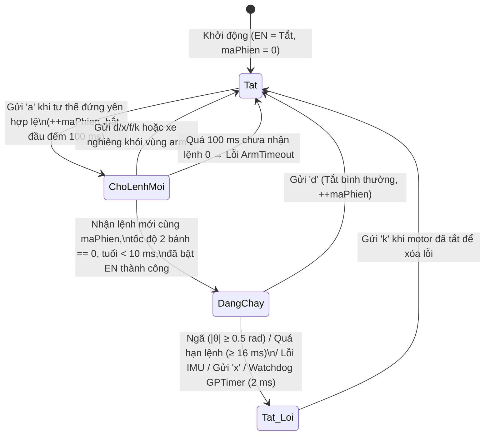

# Tổng hợp nguyên lý hoạt động chương trình xe cân bằng 2 bánh
**(ESP32-S3 Super Mini + ICM20602 + Hỗ trợ kép: MKS Servo42D/42C hoặc TMC2209 + MT6701 — Phiên bản `opt-20261110-42d`)**

---

## 1. Tổng quan hệ thống và cơ chế chọn phần cứng (`MKS` vs `TMC_MT`)

Chương trình điều khiển xe cân bằng hai bánh tự hành theo mô hình **con lắc ngược trên xe hai bánh vi sai (Two-Wheeled Inverted Pendulum)**, hỗ trợ **hai cấu hình phần cứng truyền động** có thể chuyển đổi trực tiếp trong [`MotorConfig.h`](file:///d:/DATA/Code/2WheelsBalacingRobot/include/config/MotorConfig.h#L8-L17) (qua hằng số `CAU_HINH_PHAN_CUNG_DONG_CO`) hoặc qua môi trường biên dịch PlatformIO:

| Chế độ cấu hình | Phần cứng chấp hành & phản hồi | Nguyên lý khép vòng bánh xe |
| --- | --- | --- |
| **`LoaiPhanCungDongCo::MKS`** (mặc định) | 2× **MKS Servo42C / Servo42D** chạy `CR_vFOC` | Driver MKS tự khép vòng kín nội bộ (black-box); ESP32 phát `STEP/DIR` bằng MCPWM và dùng [`WheelPulseCounter`](file:///d:/DATA/Code/2WheelsBalacingRobot/lib/motor_drv/src/WheelPulseCounter.h) (PCNT) đếm lại chính xung `STEP` đã phát (`NguonUocLuongQuangDuong::XungBuoc`). |
| **`LoaiPhanCungDongCo::TMC_MT`** | 2× **TMC2209** (`STEP/DIR/ENN`) + 2× Encoder từ **MT6701** (`AB` quadrature) | ESP32 đọc góc/vận tốc bánh thực từ MT6701 bằng phần cứng PCNT 4x qua [`Mt6701EncoderCounter`](file:///d:/DATA/Code/2WheelsBalacingRobot/lib/motor_drv/src/Mt6701EncoderCounter.h) (`NguonUocLuongQuangDuong::EncoderBanh`) và **trực tiếp khép vòng vị trí + vận tốc từng bánh** bằng [`BoDieuKhienBanhVongKin`](file:///d:/DATA/Code/2WheelsBalacingRobot/lib/controllers/BoDieuKhienBanhVongKin.h), có phát hiện kẹt rotor/trượt bước. |

1. **Tách biệt vòng dòng/vị trí motor và vòng cân bằng thân xe:**
   - MKS Servo42D/42C tự đọc encoder từ tính nội bộ và khép vòng dòng FOC + vị trí theo xung `STEP/DIR` với tần số cao bên trong driver.
   - ESP32-S3 đảm nhiệm ước lượng tư thế 3D từ cảm biến quán tính **ICM20602**, tính luật điều khiển cân bằng/di chuyển, phát xung `STEP/DIR` bằng phần cứng **MCPWM**, và đếm lại chính số cạnh xung đã phát bằng phần cứng **PCNT** để ước lượng quãng đường/vận tốc.
2. **Đầu ra của bộ điều khiển góc là gia tốc bánh xe ($a_{\text{lệnh}}$, đơn vị $\text{m/s}^2$):**
   - Để đỡ thân xe nghiêng góc $\theta$, lực quán tính cần tạo ra tỉ lệ với **gia tốc tịnh tiến của trục bánh**, không phải vận tốc.
   - Do đó, bộ PID mờ giữ góc xuất ra **gia tốc đặt** $a_{\text{lệnh}}$, sau đó tích phân theo thời gian thành **vận tốc bánh** $v_{\text{lệnh}}$ rồi quy đổi sang tần số bước `STEP/s`.
3. **An toàn đa tầng (Fail-safe):**
   - Mỗi tài nguyên phần cứng chỉ do **một tác vụ duy nhất** sở hữu.
   - Bật motor phải qua giao thức bắt tay theo **mã phiên (`maPhien`)** và xác nhận lệnh bằng $0$ mới nhất.
   - Bộ giám sát phần cứng độc lập (**GPTimer ISR** mỗi $250\,\mu\text{s}$) trực tiếp ngắt chân `EN` của MKS nếu tác vụ motor bị trễ quá $2\,\text{ms}$ hoặc lệnh điều khiển quá hạn $20\,\text{ms}$.

```mermaid
flowchart TD
    subgraph Sensor["1. Thu thập & Ước lượng (200 Hz)"]
        ICM["ICM20602 (I2C 400 kHz)"] -->|Ngắt INT Latched| ISR_IMU["imuInterrupt() ISR"]
        ISR_IMU -->|Timestamp + Seq| T_IMU["ImuTask (Prio 4)"]
        T_IMU -->|Burst INT_STATUS + 14B| Q_IMU["Queue IMU (dài 1)"]
    end

    subgraph Control["2. Điều khiển tầng (ControlTask - Prio 3)"]
        Q_IMU --> EST["ComplementaryEstimator 3D\n(Rodrigues + Bù gia tốc lệnh M5)"]
        Q_MOT["Queue MotorStatus (dài 1)"] --> ODO["DifferentialDrive\n(Đếm xung + Bù r·θ, r·θ̇ M4)"]
        ODO --> PI_V["Vòng ngoài: PI Vận tốc (50 Hz)"]
        CMD_SER["Lệnh di chuyển Serial (w/s/j/l/z)"] --> RAMP["Bộ tạo dốc (Ramp) v_mục_tiêu, ω_quay"]
        RAMP --> PI_V
        PI_V -->|Góc đặt θ_đặt| PID_A["Vòng trong: PID Mờ Sugeno 5×5 (200 Hz)\n+ Lọc PT1 40 Hz nhánh D"]
        EST -->|θ, θ̇, φ, |a|| PID_A
        EST --> SAFE["SafetyMonitor\n(Góc ngã, tuổi mẫu, độ tin cậy)"]
        ODO --> SAFE
        PID_A -->|a_lệnh (m/s²)| INT_V["Tích phân vận tốc v_lệnh\n(Có chống bão hòa hướng)"]
        INT_V -->|a_đã_lệnh| EST
        INT_V --> MIX["Bộ trộn ưu tiên cân bằng\n(tronUuTienCanBang)"]
        RAMP --> MIX
        MIX -->|STEP/s trái & phải| Q_CTRL["Queue ControlStatus (dài 1)"]
    end

    subgraph Actuation["3. Chấp hành & Giám sát (250 µs)"]
        Q_CTRL --> T_MOT["MotorTask (Prio 5, chu kỳ 250 µs)"]
        SAFE --> T_MOT
        T_MOT --> PHIEN["PhienCanBang\n(Tat → ChoLenhMoi → DangChay)"]
        T_MOT --> MKS["MksServo42DPair / 42CPair\n(Continuous ≥1000 Hz / Sparse <1000 Hz)"]
        MKS --> MCPWM["Phần cứng MCPWM\n(Phát xung STEP + quản lý DIR)"]
        MCPWM --> DRV["2× MKS Servo42D (CR_vFOC)"]
        MCPWM --> PCNT["Phần cứng PCNT\n(Đếm cạnh STEP có dấu theo DIR)"]
        PCNT --> Q_MOT
        MKS -->|Gia hạn deadline| WDT["GiamSatDongCo\n(GPTimer ISR 250 µs độc lập)"]
        WDT -->|Cắt trực tiếp khi quá hạn| EN_PIN["Chân EN (GPIO2)"]
    end
```

---

## 2. Sơ đồ kết nối phần cứng và thông số cơ khí

### 2.1. Bảng ánh xạ GPIO trên ESP32-S3 Super Mini ([PinConfig.h](file:///d:/DATA/Code/2WheelsBalacingRobot/include/config/PinConfig.h))

| Nhóm | Chức năng | Cấu hình `MKS` | Cấu hình `TMC_MT` (`pcb.pdf`) | Hướng / Mức tác dụng & Ghi chú |
| --- | --- | --- | --- | --- |
| **IMU ICM20602** | `SDA` / `SCL` | `GPIO10` / `GPIO11` | `GPIO10` / `GPIO11` | I²C $400\,\text{kHz}$, timeout giao dịch $5\,\text{ms}$ |
| | `INT` (Data-Ready) | `GPIO7` | `GPIO7` | Input, cạnh lên (`HIGH` latched), xóa bằng `INT_STATUS` |
| | `SA0` / `CS` | `GPIO8` / `GPIO9` | Nối cứng trên PCB (`-1`) | Ở chế độ `TMC_MT`, `GPIO8/9` nhường cho encoder trái |
| **Encoder MT6701** | `A` / `B` · Encoder trái | Không dùng (`-1`) | `GPIO8` / `GPIO9` | Input `PULLUP` + PCNT quadrature 4x + lọc nhiễu $1\,\mu\text{s}$ |
| | `A` / `B` · Encoder phải | Không dùng (`-1`) | `GPIO1` / `GPIO4` | Input `PULLUP` + PCNT quadrature 4x + lọc nhiễu $1\,\mu\text{s}$ |
| **Driver Trái** | `DIR` / `STEP` trái | `GPIO5` / `GPIO6` | `GPIO5` / `GPIO6` | Output MCPWM (`MKS` đếm loopback PCNT trên chính chân này) |
| **Driver Phải** | `DIR` / `STEP` phải | `GPIO12` / `GPIO13` | `GPIO12` / `GPIO13` | Output MCPWM (`mucDirTienBanhPhaiCao = false`) |
| **Cho phép Motor** | `EN` (MKS) / `ENN` (TMC2209) | `GPIO2` | `GPIO2` | Output (`LOW` = Bật, `HIGH` = Tắt), có `pull-up` nội bộ |
| **Giao diện Calib** | Nút `S3` / Đèn RGB | `GPIO3` / `GPIO48` | `GPIO3` / `GPIO48` | Nút `S3` kéo xuống GND khi nhấn; RGB WS2812 (`GRB`) |

### 2.2. Thông số cơ khí và quy đổi xung ([RobotGeometry.h](file:///d:/DATA/Code/2WheelsBalacingRobot/include/config/RobotGeometry.h), [MotorConfig.h](file:///d:/DATA/Code/2WheelsBalacingRobot/include/config/MotorConfig.h))

- Khối lượng không tải: $m = 1{,}45\,\text{kg}$; bán kính bánh: $R = 0{,}040\,\text{m}$; khoảng cách hai bánh: $B = 0{,}200\,\text{m}$.
- Chiều cao trọng tâm từ trục bánh: $l = 0{,}025\,\text{m}$; chiều dài con lắc hiệu dụng ước lượng (gồm quán tính khay/pin và phản lực stator): $L_{\text{eff}} \approx 0{,}120\,\text{m}$.
- Số xung trên một vòng bánh ($200\,\text{bước} \times 32\,\text{vi bước} \times 1{:}1$):
  $$N_{\text{vòng}} = 200 \times 32 \times 1 = 6400\,\text{xung/vòng}$$
- Quãng đường mỗi xung bước:
  $$\Delta s = \frac{2\pi R}{N_{\text{vòng}}} = \frac{2\pi \times 0{,}040}{6400} \approx 3{,}927 \times 10^{-5}\,\text{m/xung}\;(39{,}27\,\mu\text{m/xung})$$
- Trần tốc độ phần mềm mặc định ở $f_{\max} = 10\,000\,\text{STEP/s}$:
  $$v_{\max} = f_{\max} \cdot \Delta s \approx 0{,}3927\,\text{m/s}\;(\approx 93{,}75\,\text{RPM})$$

---

## 3. Phân chia tác vụ thời gian thực và quyền sở hữu dữ liệu

Chương trình tuyệt đối không dùng biến toàn cục chia sẻ không khóa giữa các vòng lặp. Mọi trao đổi trạng thái đi qua **FreeRTOS Queue dài 1 (`xQueueOverwrite` / `xQueuePeek`)** để luôn dùng mẫu mới nhất, không xếp hàng lệnh cũ:

| Thực thể | Ưu tiên / Chu kỳ | Tài nguyên sở hữu độc quyền | Nhiệm vụ chính |
| --- | --- | --- | --- |
| `imuInterrupt()` | ISR cạnh lên `GPIO7` ($200\,\text{Hz}$) | `_thoiDiemNgat_us`, `_soThuTuNgat` (dưới spinlock) | Chụp thời điểm `esp_timer_get_time()` chính xác lúc mẫu sẵn sàng và đánh thức `ImuTask` |
| `ImuTask` | Priority 4 ($200\,\text{Hz}$, theo ngắt) | Bus `Wire` (I²C) và `Icm20602Driver` | Đọc burst 15 byte (`INT_STATUS` + 14 byte dữ liệu), kiểm tra tính hợp lệ thời gian qua [`chotMauImu()`](file:///d:/DATA/Code/2WheelsBalacingRobot/src/core/ChotMauImu.h), đẩy vào `_hangDoiImu` |
| `ControlTask` | Priority 3 ($200\,\text{Hz}$, theo frame IMU) | `ComplementaryEstimator`, `DifferentialDrive`, `CascadeController` | Ước lượng góc/vận tốc, kiểm tra an toàn, chạy PI vận tốc + PID mờ góc, đẩy lệnh vào `_hangDoiTrangThaiDieuKhien` |
| `MotorTask` | Priority 5 ($4\,\text{kHz}$ / $250\,\mu\text{s}$) | `MksServo42CPair`, `WheelPulseCounter`, `PhienCanBang` | Quản lý máy trạng thái phiên bật/tắt, phát xung MCPWM liên tục/thưa, đọc PCNT, gia hạn watchdog |
| `khiBaoThuc()` | GPTimer ISR ($250\,\mu\text{s}$, IRAM) | Thanh ghi phần cứng chân `EN` (`GPIO2`) | Kiểm tra hạn phục vụ ($2\,\text{ms}$) và hạn lệnh ($20\,\text{ms}$); nếu quá hạn thì lập tức kéo `EN` về mức tắt |
| Arduino `loop()` | Priority 1 (Console, log $5\,\text{Hz}$) | `Serial`, đèn trạng thái `UI_Calib` | Đọc lệnh bàn phím (`a/d/x/k/f/h`, `w/s/j/l/z`, `i`), gửi bit sự kiện tới `MotorTask`, in telemetry mỗi $200\,\text{ms}$ |

---

## 4. Trình tự khởi động và hiệu chuẩn gá lắp IMU 3D (`UI_Calib`)

Khi cấp nguồn ([`RobotApp::begin()`](file:///d:/DATA/Code/2WheelsBalacingRobot/src/app/RobotApp.cpp#L67-L166)):

1. **Khóa an toàn chân `EN` ngay lập tức:** Kéo `GPIO2` về mức tắt kèm điện trở kéo nội bộ (`pull-up` khi `mucBatMotorCao = false`).
2. **Khởi tạo MCPWM, GPTimer và PCNT:** Kiểm tra đọc thử PCNT trả về `hopLe == true` và số đếm bằng $0$ khi motor đang tắt (tối ưu **M3**).
3. **Khởi tạo và hậu kiểm ICM20602 ([`kiemTraSauKhoiDong()`](file:///d:/DATA/Code/2WheelsBalacingRobot/lib/imu/src/Icm20602Driver.cpp#L203-L246)):**
   - Kiểm tra `WHO_AM_I (0x75) == 0x12`, reset chip, cấu hình bộ lọc số DLPF (gyro $41\,\text{Hz}$, accel $44{,}8\,\text{Hz}$), dải đo $\pm 4g$ / $\pm 500^\circ/\text{s}$, ngắt giữ mức (`0x37 = 0x20`).
   - Đọc lại toàn bộ thanh ghi cấu hình để xác nhận và thu thử **32 mẫu liên tiếp hợp lệ** trong tối đa $1{,}5\,\text{s}$. Nếu lỗi, đèn LED báo đỏ và dừng khởi động.
4. **Hiệu chuẩn bias con quay và ma trận gá lắp 3D ([`UI_Calib::chay()`](file:///d:/DATA/Code/2WheelsBalacingRobot/src/calib/UI_Calib.cpp#L213-L223), [`HieuChuanNghiengDoc`](file:///d:/DATA/Code/2WheelsBalacingRobot/lib/estimation/HieuChuanNghiengDoc.cpp)):**
   - **Bước 1 (LED Xanh dương → Vàng):** Người dùng dựng xe gần thẳng, nhấn nút `GPIO3`. Chương trình chờ $500\,\text{ms}$ cho hết rung tay, đo **500 mẫu tĩnh** để tính bias gyro 3 trục và lấy vector trọng lực đứng $\mathbf{a}_{\text{đứng}}$. Nếu có rung làm lệch chuẩn gyro $> 0{,}5^\circ/\text{s}$, cửa sổ tự động xóa và đo lại.
   - **Bước 2 (LED Lục lam → Vàng):** Hạ **ĐẦU xe** nằm xuống mặt phẳng chuẩn ($\approx +80^\circ \div 90^\circ$), nhấn nút để đo vector tĩnh $\mathbf{a}_{\text{trước}}$.
   - **Bước 3 (LED Tím → Vàng):** Nâng xe từ tư thế nằm trước, đi qua tư thế đứng rồi hạ **ĐUÔI xe** nằm xuống phía sau ($\approx -80^\circ \div 90^\circ$). Trong suốt quá trình quay, thuật toán tích lũy ma trận hiệp phương sai của vận tốc góc $\boldsymbol{\omega}$ để tìm trục chính có năng lượng quay lớn nhất — đó chính là **trục ngang $\mathbf{Y}$ của xe** (gán dấu sao cho quay từ trước ra sau có góc quay quanh $\mathbf{Y}$ âm). Sau khi nhấn nút, đo vector tĩnh $\mathbf{a}_{\text{sau}}$.
   - **Bước 4 (Dựng ma trận quay $\mathbf{R}_{\text{sensor}\to\text{xe}}$):**
     $$\mathbf{d} = \mathbf{a}_{\text{sau}} - \mathbf{a}_{\text{trước}}, \qquad \mathbf{X} = \text{normalize}\!\left(\mathbf{d} - (\mathbf{Y}\cdot\mathbf{d})\mathbf{Y}\right), \qquad \mathbf{Z} = \mathbf{X} \times \mathbf{Y}$$
     Cách dựng này **không lấy tư thế dựng tay của người dùng làm mốc $\theta = 0$**, mà dựa trên hình học hai mặt đỡ nằm trước/sau.
   - **Bước 5 (LED Trắng → Xanh lá):** Đưa xe về lại vùng gần thẳng đứng ($|\theta - \theta_{\text{cân bằng}}| \le 0{,}10\,\text{rad}$), khởi tạo các tác vụ FreeRTOS và in `READY`.

---

## 5. Thuật toán lọc tư thế 3D và bù gia tốc tịnh tiến

### 5.1. Chốt mẫu ngắt (`chotMauImu`)
Để tránh hiện tượng đọc dữ liệu mới nhưng gắn nhầm timestamp của ngắt cũ hoặc dùng mẫu poll khi đứt dây `INT`, hàm [`chotMauImu()`](file:///d:/DATA/Code/2WheelsBalacingRobot/src/core/ChotMauImu.h) chỉ chấp nhận mẫu khi:
- Đánh thức thật sự đến từ ngắt (`coThongBao == true`, `thoiDiemNgat_us > 0`);
- Không có ngắt mới chồng lên trong lúc đang đọc I²C (`soNgatTruoc == soNgatSau`);
- Thời gian từ lúc ngắt tới lúc đọc xong nhỏ hơn đúng 1 chu kỳ mẫu ($< 5000\,\mu\text{s}$). Nhờ nâng I²C lên $400\,\text{kHz}$ (tối ưu **L2**), thời gian đọc burst 15 byte chỉ còn $\approx 410\,\mu\text{s}$.

### 5.2. Bộ lọc bổ sung trên mặt cầu đơn vị ([`ComplementaryEstimator`](file:///d:/DATA/Code/2WheelsBalacingRobot/lib/estimation/ComplementaryEstimator.cpp))
Thay vì tích phân góc Euler 1D dễ bị trôi và lệch khi xe vừa nghiêng vừa quay yaw/roll, bộ lọc duy trì **vector đơn vị chỉ phương thẳng đứng hướng lên** $\mathbf{u} = [u_x, u_y, u_z]^T$ trong hệ trục xe ($X$ tiến, $Y$ trái, $Z$ lên):

1. **Xoay cảm biến sang hệ xe:**
   $$\mathbf{a}_{\text{đo}} = \mathbf{R}\,\mathbf{a}_{\text{sensor}}, \qquad \boldsymbol{\omega} = \mathbf{R}\,\boldsymbol{\omega}_{\text{sensor}}$$
2. **Bù gia tốc tịnh tiến đã ra lệnh (Tối ưu M5):**
   Cảm biến gia tốc đo lực riêng $\mathbf{f} = \mathbf{a}_{\text{tịnh tiến}} + g\,\mathbf{u}$. Khi xe tăng tốc tiến với gia tốc đã lệnh $a_{\text{cmd}}$, thành phần ngang tiến trong hệ xe là $\mathbf{h} = \text{normalize}(\mathbf{e}_x - u_x \mathbf{u})$. Bộ lọc trừ phần gia tốc đã biết trước khi chuẩn hóa:
   $$\mathbf{a} = \mathbf{a}_{\text{đo}} - \text{clamp}(a_{\text{cmd}}, -4, +4)\,\mathbf{h}, \qquad \mathbf{u}_{\text{acc}} = \frac{\mathbf{a}}{\|\mathbf{a}\|}$$
   Nhờ vậy khi xe tăng/giảm tốc mạnh để đỡ thân, vector $\mathbf{u}_{\text{acc}}$ không bị kéo lệch tới $17^\circ$ như khi chưa bù.
3. **Dự đoán bằng công thức quay Rodrigues với $-\boldsymbol{\omega}\,\Delta t$:**
   Vì hệ quy chiếu gắn với thân xe quay với vận tốc góc $\boldsymbol{\omega}$, vector phương đứng cố định ngoài không gian sẽ quay ngược lại trong hệ trục xe một góc $\Delta\psi = \|\boldsymbol{\omega}\|\Delta t$ quanh trục $\mathbf{k} = \boldsymbol{\omega}/\|\boldsymbol{\omega}\|$:
   $$\mathbf{u}_{\text{pred}} = \mathbf{u}\cos\Delta\psi - (\mathbf{k} \times \mathbf{u})\sin\Delta\psi + \mathbf{k}(\mathbf{k}\cdot\mathbf{u})(1 - \cos\Delta\psi)$$
4. **Trọng số tin cậy động và hợp nhất:**
   Độ tin cậy $w_{\text{trust}} \in [0, 1]$ giảm tuyến tính khi độ lớn $\|\mathbf{a}\|$ lệch khỏi $g = 9{,}80665\,\text{m/s}^2$ quá $2{,}5\,\text{m/s}^2$ hoặc khi góc lệch $\arccos(\mathbf{u}_{\text{pred}}\cdot\mathbf{u}_{\text{acc}})$ vượt $0{,}08 \to 0{,}25\,\text{rad}$:
   $$\beta = w_{\text{trust}} \frac{\Delta t}{\tau_{\text{góc}} + \Delta t}\quad(\tau_{\text{góc}} = 0{,}4\,\text{s}), \qquad \mathbf{u} \leftarrow \text{normalize}\!\left(\mathbf{u}_{\text{pred}} + \beta(\mathbf{u}_{\text{acc}} - \mathbf{u}_{\text{pred}})\right)$$
5. **Trích xuất góc nghiêng dọc (Pitch) và tốc độ nghiêng Euler:**
   $$\theta = \text{atan2}\!\left(-u_x, \sqrt{u_y^2 + u_z^2}\right), \qquad \dot{\theta} = \frac{u_z \omega_y - u_y \omega_z}{\sqrt{u_y^2 + u_z^2}}$$
   Quy ước: **thân xe nghiêng về phía trước thì $\theta > 0$ và $\dot{\theta} > 0$**.

---

## 6. Ước lượng chuyển động bánh xe và cấu trúc điều khiển tầng

### 6.1. Đếm xung PCNT và bù động học thân xe ([`DifferentialDrive`](file:///d:/DATA/Code/2WheelsBalacingRobot/lib/kinematics/DifferentialDrive.cpp))
- Phần cứng **PCNT** đếm cạnh lên trên chính chân xuất `STEP` của từng bánh, tự động cộng khi `DIR` ở mức tiến và trừ khi `DIR` ở mức lùi, có tích lũy chống tràn 16-bit sang biến 64-bit.
- **Bù góc nghiêng thân xe (Tối ưu M4):** Vì vỏ (stator) của động cơ bước gắn chặt vào thân xe, khi thân xe nghiêng tới một góc $\theta$ mà bánh xe đứng yên trên mặt đất thì trục bánh vẫn quay tương đối so với thân một góc $-\theta$. Do đó, vị trí và vận tốc thực của tâm bánh trên mặt đất là:
  $$x = \frac{N_L + N_R}{2}\Delta s + R\,\theta, \qquad v_{\text{raw}} = \frac{\Delta N_L + \Delta N_R}{2\,\Delta t}\Delta s + R\,\dot{\theta}$$
- Vận tốc $v_{\text{raw}}$ được làm mượt qua bộ lọc thông thấp bậc một hằng số thời gian $\tau_v = 0{,}03\,\text{s}$:
  $$v_k = v_{k-1} + \frac{\Delta t}{\tau_v + \Delta t}(v_{\text{raw}} - v_{k-1})$$

### 6.2. Vòng ngoài: Bộ tạo dốc (Ramp) và điều khiển PI vận tốc ($50\,\text{Hz}$)
Trong [`CascadeController::update()`](file:///d:/DATA/Code/2WheelsBalacingRobot/lib/controllers/CascadeController.cpp):
- Lệnh người dùng từ Serial (`w/s` = $\pm 0{,}15\,\text{m/s}$, `j/l` = $\pm 0{,}60\,\text{rad/s}$, thời hạn $500\,\text{ms}$) được giới hạn tốc độ biến thiên (slew-rate) ở mức $0{,}50\,\text{m/s}^2$ và $2{,}0\,\text{rad/s}^2$ để tạo $v_{\text{mục tiêu}}$ và $\omega_{\text{quay mục tiêu}}$ mượt.
- Cứ mỗi $20\,\text{ms}$ ($50\,\text{Hz}$), bộ PI vận tốc tính góc nghiêng đặt $\theta_{\text{đặt}}$:
  $$e_v = v_{\text{mục tiêu}} - v, \qquad \theta_{\text{đặt}} = \theta_{\text{cân bằng}} + \text{clamp}\!\left(K_{p,v} e_v + K_{i,v} \int e_v\,dt,\; -\theta_{\max},\; +\theta_{\max}\right)$$
  với $K_{p,v} = 0{,}15\,\text{rad/(m/s)}$, $K_{i,v} = 0{,}03\,\text{rad/m}$, $\theta_{\max} = 0{,}10\,\text{rad}$ ($\approx 5{,}7^\circ$).
- **Ý nghĩa vật lý:** Nếu xe đang bị trôi về phía trước ($v > 0$, $v_{\text{mục tiêu}} = 0$) thì $e_v < 0 \Rightarrow \theta_{\text{đặt}} < 0$ (yêu cầu thân xe ngả nhẹ về phía sau). Để làm thân ngả về sau, vòng góc sẽ tăng tốc bánh về phía trước vượt qua trọng tâm rồi hãm xe dừng lại.

### 6.3. Vòng trong: Bộ điều khiển PID mờ Sugeno 25 luật ($200\,\text{Hz}$)
Trong [`AnglePidController::update()`](file:///d:/DATA/Code/2WheelsBalacingRobot/lib/controllers/AnglePidController.cpp):
1. **Lọc nhiễu nhánh vi phân (D):** Tốc độ nghiêng $\dot{\theta}$ đi qua bộ lọc thông thấp PT1 tần số cắt danh nghĩa $f_c = 40\,\text{Hz}$ ($\dot{\theta}_D$), trong khi nhánh tỉ lệ (P) dùng trực tiếp góc $\theta$ không lọc thêm để không gây trễ pha. Đạo hàm tính trên tín hiệu đo $\dot{\theta}_D$ thay vì $d(\theta - \theta_{\text{đặt}})/dt$ để triệt tiêu xung đạo hàm (derivative kick) khi $\theta_{\text{đặt}}$ thay đổi.
2. **Suy luận mờ Sugeno bậc 0 ($5 \times 5 = 25$ luật):**
   - Hai đầu vào chuẩn hóa về $[-1, 1]$ với miền tối ưu **M1** khớp vùng chưa bão hòa gia tốc:
     $$E = \text{clamp}\!\left(\frac{\theta - \theta_{\text{đặt}}}{0{,}07\,\text{rad}}, -1, 1\right), \qquad \dot{E} = \text{clamp}\!\left(\frac{\dot{\theta}_D}{0{,}70\,\text{rad/s}}, -1, 1\right)$$
   - Năm tập mờ tam giác phân hoạch đơn vị `NB, NS, Z, PS, PB` có tâm tại $\{-1,\;-0{,}5,\;0,\;+0{,}5,\;+1\}$.
   - Hệ số nhân tự chỉnh:
     - $K_p \in [1{,}0;\; 1{,}4] \times K_{p0}$: tăng khi $|E|$ lớn và $\dot{E}$ cùng dấu (xe đang đổ nhanh ra xa vị trí cân bằng).
     - $K_d \in [1{,}0;\; 1{,}5] \times K_{d0}$: tăng mạnh khi $E$ và $\dot{E}$ trái dấu hoặc tốc độ góc lớn để giảm vọt lố khi thân xe lao về vị trí thẳng đứng.
     - $K_i \in [0{,}0;\; 1{,}0] \times K_{i0}$: chỉ bật khi cả $E$ và $\dot{E}$ rất gần $0$ (`Z`) để khử sai lệch tĩnh mà không gây tích lũy bão hòa khi nghiêng lớn.
3. **Luật tính gia tốc và tích phân vận tốc có chống bão hòa hướng:**
   $$a_{\text{lệnh}} = \text{clamp}\!\left(K_p(\theta - \theta_{\text{đặt}}) + K_i I_\theta + K_d \dot{\theta}_D,\; -3{,}0,\; +3{,}0\right)\;\text{m/s}^2$$
   $$v_{\text{lệnh}, k} = \text{clamp}\!\left(v_{\text{lệnh}, k-1} + a_{\text{lệnh}}\,\Delta t,\; -v_{\max},\; +v_{\max}\right)$$
   Khâu tích phân $I_\theta$ tự động khóa nếu $v_{\text{lệnh}}$ đã chạm trần $\pm v_{\max}$ cùng chiều với sai lệch góc, nhưng vẫn cho phép tích phân theo chiều ngược lại để thoát bão hòa ngay khi thân xe đổi hướng.

### 6.4. Bộ trộn hai bánh ưu tiên cân bằng ([`BoTronLenhBanh.h`](file:///d:/DATA/Code/2WheelsBalacingRobot/lib/kinematics/BoTronLenhBanh.h))
Thành phần vận tốc cân bằng $v_{\text{lệnh}}$ luôn được bảo toàn tuyệt đối; phần chênh lệch quay $\Delta v = \omega_{\text{quay}} \cdot B / 2$ chỉ được phép dùng phần dư địa còn lại tới trần tốc độ $v_{\max}$:
$$v_{\text{dư}} = \max\!\left(0,\; v_{\max} - |v_{\text{lệnh}}|\right), \qquad \Delta v = \text{clamp}\!\left(\frac{\omega_{\text{quay}} B}{2},\; -v_{\text{dư}},\; +v_{\text{dư}}\right)$$
$$v_{\text{đặt, trái}} = v_{\text{lệnh}} - \Delta v, \qquad v_{\text{đặt, phải}} = v_{\text{lệnh}} + \Delta v$$

### 6.5. Bộ xử lý logic bánh xe vòng kín cho cấu hình `TMC2209 + MT6701` ([`BoDieuKhienBanhVongKin`](file:///d:/DATA/Code/2WheelsBalacingRobot/lib/controllers/BoDieuKhienBanhVongKin.cpp))
Khi chọn `LoaiPhanCungDongCo::TMC_MT`, thay vì gửi trực tiếp $v_{\text{đặt, trái/phải}}$ ra xung `STEP` vòng hở, [`CascadeController`](file:///d:/DATA/Code/2WheelsBalacingRobot/lib/controllers/CascadeController.cpp#L68-L76) đưa lệnh của từng bánh qua [`BoDieuKhienBanhVongKin::capNhat()`](file:///d:/DATA/Code/2WheelsBalacingRobot/lib/controllers/BoDieuKhienBanhVongKin.cpp#L48-L93) với phản hồi vị trí $s_{\text{đo}, i}$ và vận tốc $v_{\text{đo}, i}$ thực từ encoder từ tính **MT6701** ($4096\,\text{cạnh/vòng}$, $\Delta s_{\text{enc}} \approx 61{,}36\,\mu\text{m/cạnh}$):

1. **Đồng bộ êm khi khởi động / bật lại (`_daDongBo`):**
   Ở mẫu đầu tiên sau khi arm hoặc reset, vị trí tham chiếu được gán bằng chính vị trí encoder hiện tại ($s_{\text{ref}, i} \leftarrow s_{\text{đo}, i}$). Nhờ vậy dù xe có bị đẩy tay khi motor tắt, bánh xe cũng không bao giờ giật về vị trí cũ.
2. **Luật điều khiển Feedforward + P vị trí + PI vận tốc có chống bão hòa:**
   $$s_{\text{ref}, i}(k) = s_{\text{ref}, i}(k-1) + v_{\text{đặt}, i}\,\Delta t, \qquad e_{s, i} = \text{clamp}\!\left(s_{\text{ref}, i} - s_{\text{đo}, i},\; -e_{s,\max},\; +e_{s,\max}\right)$$
   $$\Delta v_{\text{bù}, i} = \text{clamp}\!\left(K_{p,s}\,e_{s, i} + K_{p,v}(v_{\text{đặt}, i} - v_{\text{đo}, i}) + K_{i,v} \int (v_{\text{đặt}, i} - v_{\text{đo}, i})\,dt,\; -\Delta v_{\text{bù},\max},\; +\Delta v_{\text{bù},\max}\right)$$
   $$v_{\text{out}, i} = \text{clamp}\!\left(v_{\text{đặt}, i} + \Delta v_{\text{bù}, i},\; -v_{\max},\; +v_{\max}\right), \qquad f_{\text{step}, i} = \frac{v_{\text{out}, i}}{\Delta s_{\text{step}}}$$
3. **Phát hiện kẹt rotor / mất bước kéo dài (`biKetBanh`):**
   Nếu độ lệch góc trục bánh $|e_{\phi, i}| = |e_{s, i}| / R \ge \text{gocLoiBamBanhToiDa\_rad}$ ($0{,}45\,\text{rad} \approx 25{,}8^\circ$) liên tục trong thời gian $\ge \text{thoiGianKetBanhToiDa\_s}$ ($150\,\text{ms}$), bộ điều khiển trả về `false` (`biKetBanh = true`) để `ControlTask` / `MotorTask` ngắt `ENN` ngay lập tức và giữ lỗi an toàn.

---

## 7. Cơ chế phát xung phần cứng MCPWM và bảo vệ đảo chiều

Lớp [`MksServo42CPair`](file:///d:/DATA/Code/2WheelsBalacingRobot/lib/motor_drv/src/MksServo42C.cpp) (tương thích `MksServo42DPair`) điều khiển mỗi bánh qua [`McpwmStepOutput`](file:///d:/DATA/Code/2WheelsBalacingRobot/lib/motor_drv/src/McpwmStepOutput.cpp) với độ phân giải timer $1\,\text{MHz}$ ($1\,\text{tick} = 1\,\mu\text{s}$), độ rộng mức cao mỗi xung `STEP` cố định $10\,\mu\text{s}$:

1. **Hai chế độ phát xung không gián đoạn ở tốc độ thấp:**
   - **Chế độ liên tục (`Continuous`, $|f| \ge 1000\,\text{STEP/s}$):** Timer MCPWM chạy chu kỳ $T = \lceil 10^6 / |f| \rceil\,\mu\text{s}$ ($\le 1\,\text{ms}$), tự động cập nhật chu kỳ mới tại sự kiện `EMPTY` để không bao giờ cắt ngắn xung `HIGH` đang phát.
   - **Chế độ xung thưa (`Sparse`, $0 < |f| < 1000\,\text{STEP/s}$):** Mỗi chu kỳ phục vụ $250\,\mu\text{s}$, driver cộng dồn phần bước lẻ $\Delta n = |f| \cdot \Delta t$. Khi tích lũy đủ $\ge 1{,}0\,\text{bước}$ và bộ phát đã rảnh, phần cứng phát **đúng một xung đơn (`MCPWM_TIMER_START_STOP_FULL`)** rồi trừ đi $1{,}0$. Cách này giúp xe giữ thăng bằng êm quanh vận tốc $0$ mà không ép tốc độ tối thiểu hay dùng `delay()` phần mềm. Nếu task bị trễ làm tồn đọng $\ge 2{,}0\,\text{bước}$, driver lập tức ngắt lỗi `SparseBacklog` chứ không phát bù cả cụm xung gây giật.
2. **Máy trạng thái bảo vệ khi đổi chiều `DIR` (`Running → Pausing → DirSetup → Idle → Running`):**
   - Không bao giờ đảo chân `DIR` khi chân `STEP` đang ở mức `HIGH`.
   - Khi cần đổi chiều hoặc chuyển chế độ: cấm cạnh lên kế tiếp (`pauseAfterPulse()`), chờ xung hiện tại kết thúc + thời gian giữ `DIR hold` ($10\,\mu\text{s}$), đổi mức logic chân `DIR`, chờ tiếp thời gian thiết lập `DIR setup` ($10\,\mu\text{s}$) rồi mới cho phép phát xung trở lại.

---

## 8. Hệ thống an toàn đa tầng và đồng bộ phiên (`PhienCanBang`)



### Tổng hợp các ngưỡng bảo vệ hiện hành ([SafetyConfig.h](file:///d:/DATA/Code/2WheelsBalacingRobot/include/config/SafetyConfig.h))

| Bảo vệ | Ngưỡng khi Bật (`canArm`) | Ngưỡng khi Chạy (`check` / Runtime) | Hành động khi vi phạm |
| --- | --- | --- | --- |
| Góc nghiêng dọc $|\theta - \theta_{\text{cb}}|$ | $\le 0{,}10\,\text{rad}$ ($\approx 5{,}7^\circ$) | $< 0{,}50\,\text{rad}$ ($\approx 28{,}6^\circ$) | Reset PID, `emergencyStop()`, chốt lỗi `fallen` |
| Góc nghiêng ngang $|\phi|$ | $\le 0{,}10\,\text{rad}$ | $< 0{,}50\,\text{rad}$ | Reset PID, `emergencyStop()`, chốt lỗi `fallen` |
| Tốc độ góc $|\dot{\theta}|, |\dot{\phi}|$ | $\le 0{,}35\,\text{rad/s}$ | Hữu hạn | Từ chối bật nếu xe đang lắc |
| Độ lớn gia tốc $\|\mathbf{a}_{\text{đo}}\|$ | $9{,}80665 \pm 2{,}5\,\text{m/s}^2$ (`giaTocTinCay`) | $[2{,}0;\; 30{,}0]\,\text{m/s}^2$ | Ngắt lỗi `imu_invalid` (chặn cả mẫu toàn $0$) |
| Tuổi mẫu góc IMU | $< 20\,\text{ms}$ | $< 20\,\text{ms}$ | Ngắt lỗi `imu_stale` |
| Tuổi lệnh điều khiển tại `MotorTask` | $< 10\,\text{ms}$ (`tuoiLenhDeBat_us`) | $< 16\,\text{ms}$ (`tuoiLenhKhiChay_us` — **H1**) | Cho phép mất 1–2 mẫu IMU lẻ khi chạy; quá $16\,\text{ms}$ dừng khẩn |
| Khoảng cách 2 khung xung tính $v$ | $\le 25\,\text{ms}$ (`khoangCachKhungXungToiDa_us` — **H1**) | $\le 25\,\text{ms}$ | Giữ vận tốc hợp lệ qua 1–3 mẫu IMU bị bỏ |
| Hạn phục vụ `MotorTask` | — | $\le 2\,\text{ms}$ (`khoangCachPhucVuMotorToiDa_us`) | **GPTimer ISR** cắt trực tiếp `GPIO2 (EN)` trong phần cứng |
| Hạn lệnh tuyệt đối ở Driver | — | $< 20\,\text{ms}$ (`thoiGianHetHanLenhMotor_us`) | **GPTimer ISR** cắt `EN` + giữ lỗi `WatchdogExpired` |

---

## 9. Tóm tắt các tối ưu đã thực hiện trong đợt này (10/11/2026)

1. **H1 — Chống dừng khẩn giả khi rớt 1 mẫu IMU ([SafetyConfig.h](file:///d:/DATA/Code/2WheelsBalacingRobot/include/config/SafetyConfig.h), [RobotApp.cpp](file:///d:/DATA/Code/2WheelsBalacingRobot/src/app/RobotApp.cpp), [DifferentialDrive.cpp](file:///d:/DATA/Code/2WheelsBalacingRobot/lib/kinematics/DifferentialDrive.cpp)):** Tách `tuoiLenhKhiChay_us = 16000` (so với `tuoiLenhDeBat_us = 10000`) và `khoangCachKhungXungToiDa_us = 25000` (so với `tuoiXungToiDa_us = 10000`). Xe không còn bị `emergencyStop()` chỉ vì 1 mẫu IMU bị loại do trùng/trễ.
2. **H2 — Tương thích tường minh MKS Servo42D ([MksServo42C.h](file:///d:/DATA/Code/2WheelsBalacingRobot/lib/motor_drv/src/MksServo42C.h), [MksServo42D.h](file:///d:/DATA/Code/2WheelsBalacingRobot/lib/motor_drv/src/MksServo42D.h), [MotorConfig.h](file:///d:/DATA/Code/2WheelsBalacingRobot/include/config/MotorConfig.h)):** Bổ sung alias `MksServo42DPair`, header `MksServo42D.h` và checklist cấu hình menu 42D (`CR_vFOC`, `MStep=32`, `En=L`, lưu ý chân `COM` và `Protect`).
3. **H3 — Mô hình con lắc hiệu dụng $L_{\text{eff}}$ có trễ truyền ([RobotGeometry.h](file:///d:/DATA/Code/2WheelsBalacingRobot/include/config/RobotGeometry.h), [control_tests.cpp](file:///d:/DATA/Code/2WheelsBalacingRobot/test/native/control_tests.cpp)):** Khai báo `chieuDaiConLacHieuDung_m = 0.120f` và bổ sung bài kiểm thử `delayedEffectivePendulumTest()` với trễ truyền $10\,\text{ms}$ (2 chu kỳ mẫu) cho cả PD cố định và PD mờ.
4. **M1 — Khớp miền PID mờ với vùng chưa bão hòa ([ControlConfig.h](file:///d:/DATA/Code/2WheelsBalacingRobot/include/config/ControlConfig.h)):** Thu miền chuẩn hóa mờ về `mienSaiLechMo_rad = 0.07f` ($\approx 4^\circ$) và `mienTocDoMo_radps = 0.7f` để toàn bộ 25 luật mờ phát huy tác dụng trước khi chạm trần gia tốc $\pm 3\,\text{m/s}^2$.
5. **M3 — Hậu kiểm PCNT lúc khởi động & ghi nhận phiên bản PlatformIO ([WheelPulseCounter.cpp](file:///d:/DATA/Code/2WheelsBalacingRobot/lib/motor_drv/src/WheelPulseCounter.cpp), [platformio.ini](file:///d:/DATA/Code/2WheelsBalacingRobot/platformio.ini)):** Kiểm tra đọc thử PCNT ngay trong `WheelPulseCounter::begin()` và ghi nhận phiên bản platform `55.03.39` (Arduino `3.3.9` / ESP-IDF `5.5.4`).
6. **M4 — Bù động học góc thân xe vào quãng đường và vận tốc ([DifferentialDrive.cpp](file:///d:/DATA/Code/2WheelsBalacingRobot/lib/kinematics/DifferentialDrive.cpp), [ControlConfig.h](file:///d:/DATA/Code/2WheelsBalacingRobot/include/config/ControlConfig.h)):** Cộng $R\theta$ vào vị trí dọc và $R\dot{\theta}$ vào vận tốc dọc (`buGocThanVaoQuangDuong = true`).
7. **M5 — Bù gia tốc tịnh tiến đã lệnh vào bộ lọc IMU ([ComplementaryEstimator.cpp](file:///d:/DATA/Code/2WheelsBalacingRobot/lib/estimation/ComplementaryEstimator.cpp), [CascadeController.cpp](file:///d:/DATA/Code/2WheelsBalacingRobot/lib/controllers/CascadeController.cpp), [RobotApp.cpp](file:///d:/DATA/Code/2WheelsBalacingRobot/src/app/RobotApp.cpp)):** Trừ gia tốc bánh thực sự đã ra lệnh khỏi vector gia tốc đo trước khi tính phương trọng lực (`buGiaTocLenhVaoImu = true`).
8. **L1 & L2 — Kéo nội bộ chân `EN` về mức tắt & nâng I²C lên $400\,\text{kHz}$ ([ImuConfig.h](file:///d:/DATA/Code/2WheelsBalacingRobot/include/config/ImuConfig.h), [RobotApp.cpp](file:///d:/DATA/Code/2WheelsBalacingRobot/src/app/RobotApp.cpp)):** Giảm thời gian đọc burst 15 byte trên dây từ $\approx 1{,}62\,\text{ms}$ xuống $\approx 0{,}41\,\text{ms}$.
